# Лабораторная работа №2. Эксплуатация OpenSearch

## Часть 1. Развертывание

В первой части нужно было развернуть кластер OpenSearch с архитектурой Hot–Warm, настроить TLS для Transport и REST API и запустить OpenSearch Dashboards. Все делал через **Ansible, без Docker**. В итоге кластер работает на трех виртуальных машинах Ubuntu Server в Яндекс Облаке, версия OpenSearch и Dashboards **3.9.0**.

### Развертывание кластера

Кластер `opensearch-lab` состоит из трех узлов:

| Узел | Внутренний IP | Роли | Назначение |
|---|---|---|---|
| `os-hot` | `10.128.0.22` | `data`, `cluster_manager`, `ingest` | Актуальные данные, Hot |
| `os-warm` | `10.130.0.17` | `data`, `cluster_manager` | Менее актуальные данные, Warm |
| `os-manager` | `10.131.0.30` | `cluster_manager` | Управление кластером и Dashboards |

Для установки я адаптировал официальные Ansible-роли OpenSearch под свой проект (`roles/opensearch` и `roles/dashboards`). Остальную настройку вынес в отдельные роли: `lab_hot_warm`, `lab_dashboards_tls` и `lab_verify`. Адреса для SSH и внутреннего взаимодействия узлов задаются в `host_vars` через переменные окружения, поэтому после переезда в облако не пришлось переписывать всю конфигурацию. В `group_vars/all/main.yml` находятся общие параметры кластера.

Сначала проверяется inventory и Java 21+ на управляющем компьютере, она нужна для генерации сертификатов. Затем последовательно запускаются playbook:

```bash
ansible-playbook playbooks/00-check-configuration.yml
ansible-playbook playbooks/02-opensearch.yml -b --ask-become-pass
ansible-playbook playbooks/03-dashboards.yml -b --ask-become-pass
ansible-playbook playbooks/04-hot-warm.yml -b --ask-become-pass
ansible-playbook playbooks/05-dashboards-tls.yml -b --ask-become-pass
ansible-playbook playbooks/06-verify.yml -b --ask-become-pass
```

`02-opensearch.yml` устанавливает OpenSearch из архива, создает пользователя и systemd-сервис, настраивает кластер и Security Plugin. Во время установки генерируется собственный корневой CA и сертификаты узлов. Они используются для защищенного Transport-соединения на порту **9300** и HTTPS REST API на порту **9200**. Сервисы включены в автозапуск через systemd.

В `04-hot-warm.yml` узлам с данными добавляются атрибуты `node.attr.temp: hot` и `node.attr.temp: warm`. При изменении конфигурации узлы перезапускаются **по одному**, чтобы не нарушать работу кластера. Пока это именно разметка узлов по уровням хранения; правила переноса индексов будут настраиваться в следующих частях работы.


### Проблемы при настройке

Больше всего времени ушло на попытку собрать кластер локально. Сначала `os-hot` работал в VirtualBox на ноутбуке с Linux, а `os-warm` и `os-manager` в VMware на втором ноутбуке с Windows. При этом виртуалки нормально пинговались, подключались по SSH, порты были доступны, а TLS-проверки проходили. Но именно **кластер OpenSearch не собирался**: `os-hot` видел только себя, а при попытке присоединиться к остальным узлам возникали ошибки Transport handshake и `Connection reset`.

Из-за этого зависала команда `securityadmin.sh`, которая ждала готовности кластера для загрузки настроек безопасности. За время отладки пришлось исправлять IP и `/etc/hosts`, проверять сертификаты, логи Java и OpenSearch и даже сравнивать сетевые пакеты через `tcpdump`. Однозначную причину сброса соединений между двумя ноутбуками так и не удалось установить.

Параллельно выяснилось, что для нормальной работы каждой ВМ желательно выделить около **4 ГБ ОЗУ**, а один ноутбук все три машины одновременно не тянул. Поэтому я решил отказаться от локального варианта и **перенести кластер в Яндекс Облако**. После настройки облачных IP-адресов и SSH все три узла смогли объединиться в один кластер.

### OpenSearch Dashboards и HTTPS

Dashboards установлен на `os-manager` и работает на порту **5601**. В `05-dashboards-tls.yml` для него создается отдельный серверный сертификат, подписанный тем же CA, включается `server.ssl.enabled: true`, проверка сертификата OpenSearch (`opensearch.ssl.verificationMode: full`) и защищенные cookies.

Так как на ВМ нет графического интерфейса, страницу Dashboards я открыл в браузере своего ноутбука через **SSH-туннель** на локальный порт `15601`. Сначала браузер ругался на сертификат: он не доверял учебному CA и я открывал сайт через `localhost`. В итоге добавил публичный `root-ca.pem` в доверенные и настроил локальное имя `os-manager.lab.internal`. После этого Dashboards открылся по HTTPS без ошибки сертификата.


### Проверка результата

Состав кластера проверял через `/_cat/nodes?v`: в ответе видны **все три узла**.


Через `/_cat/nodeattrs?v` проверил атрибуты: у `os-hot` — `temp: hot`, у `os-warm` — `temp: warm`.


Последний playbook `06-verify.yml` проверяет состояние кластера по HTTPS с проверкой CA, число узлов, атрибуты Hot/Warm и доступность Dashboards. Он завершился без ошибок и показал:

```text
cluster: opensearch-lab
status: green
total_nodes: 3
data_nodes: 2
dashboards_http_status: 302
```

Код `302` здесь нормальный: Dashboards перенаправляет на страницу авторизации. В итоге **все требования первой части выполнены**.


## Часть 2. Ролевая модель

Во второй части лабораторной работы нужно было создать три роли с разными правами доступа и трех пользователей, которым эти роли будут назначены. Все настраивалось через Ansible с использованием **OpenSearch Security REST API**, без переустановки или перезапуска кластера.

Для этого я создал отдельную роль `roles/rbac` и два playbook: `07-rbac.yml` для настройки пользователей и ролей и `08-rbac-verify.yml` для проверки их прав.

### Создание ролей

Были подготовлены три роли:

| Роль | Назначение |
|---|---|
| `logs_writer` | Запись документов только в data stream `logs` |
| `logs_reader` | Чтение индексов, соответствующих шаблону `logs*` |
| `cluster_monitor` | Получение состояния и метрик кластера и его узлов |

Для `logs_writer` используются разрешения `indices:data/write/index` и `indices:data/write/bulk*`. Роль предназначена для добавления документов в поток логов, без прав на удаление индексов или изменение настроек кластера.

Роль `logs_reader` получает группу разрешений `read` для индексов `logs*`, а `cluster_monitor` — только необходимые права `cluster:monitor/health`, `cluster:monitor/stats` и `cluster:monitor/nodes/stats`.

Роли создаются через запросы `PUT` к Security REST API:

```text
/_plugins/_security/api/roles/<role_name>
```

Для подключения Ansible использует существующие сертификаты администратора `admin.pem`, `admin.key` и корневой `root-ca.pem`. Таким образом, управление безопасностью выполняется через HTTPS с проверкой сертификатов.

### Создание пользователей

Для каждой роли был предусмотрен отдельный пользователь:

| Пользователь | Роль |
|---|---|
| `logs_writer_user` | `logs_writer` |
| `logs_reader_user` | `logs_reader` |
| `monitor_user` | `cluster_monitor` |

Пользователи создаются через `PUT /_plugins/_security/api/internalusers/<username>`. При создании каждому сразу назначается соответствующая роль через `opendistro_security_roles`.

Пароли не хранятся в открытом виде в Ansible-ролях. Для них используется **Ansible Vault**, а в задачах создания пользователей установлен `no_log: true`, чтобы пароли не попадали в вывод playbook.

Настройка запускается командой:

```bash
ansible-playbook playbooks/07-rbac.yml \
  -b --ask-become-pass --ask-vault-pass
```

При первом запуске роли создались успешно, но при создании пользователей возникла проблема: два запроса вернули ошибку `HTTP 404`, а один завершился успешно. Из-за `no_log: true` подробности ошибки были скрыты. Для диагностики предусмотрен отдельный вывод HTTP-статуса и сообщения API без отображения паролей.


### Проверка разграничения доступа

Для проверки был подготовлен отдельный playbook:

```bash
ansible-playbook playbooks/08-rbac-verify.yml \
  -b --ask-become-pass --ask-vault-pass
```

Он использует API `/_plugins/_security/authinfo`, чтобы проверить аутентификацию пользователей и назначенные им роли.

Дополнительно предусмотрены запросы к `/_cluster/health`, `/_cluster/stats` и `/_nodes/stats`. Пользователь `monitor_user` должен успешно получать эти метрики, а пользователям чтения и записи доступ к статистике кластера должен быть запрещен с кодом `403 Forbidden`.


Таким образом, во второй части была подготовлена ролевая модель OpenSearch и автоматизированные сценарии ее настройки и проверки. Основные разрешения разделены между записью логов, чтением и мониторингом, а пароли вынесены в Ansible Vault. На момент последнего запуска оставалось разобраться с ошибкой создания двух пользователей и завершить проверку их доступа.

## Часть 3. Управление индексами

В третьей части лабораторной работы нужно было настроить сбор логов Nginx в формате JSON, их отправку в OpenSearch и автоматическое управление индексами. Все снова делал через Ansible, без Docker. Для этого подготовил отдельные роли `lab_nginx_json`, `lab_fluentbit` и `lab_logs_ism`.

### Nginx и сбор логов

На узле `os-hot` развернул Nginx с простой HTML-страницей, которая доступна на локальном порту `8080`. Для access log настроил JSON-формат через `log_format` с параметром `escape=json`.

Каждая запись содержит время запроса (`@timestamp`), IP клиента, HTTP-метод, URL, код ответа, размер ответа и время обработки. Логи сохраняются в файл `/var/log/nginx/opensearch-access.json`.

Для проверки достаточно несколько раз обратиться к странице и посмотреть содержимое файла:

`sudo tail -n 5 /var/log/nginx/opensearch-access.json | jq .`

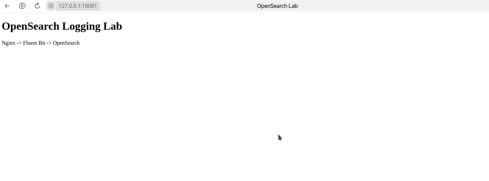
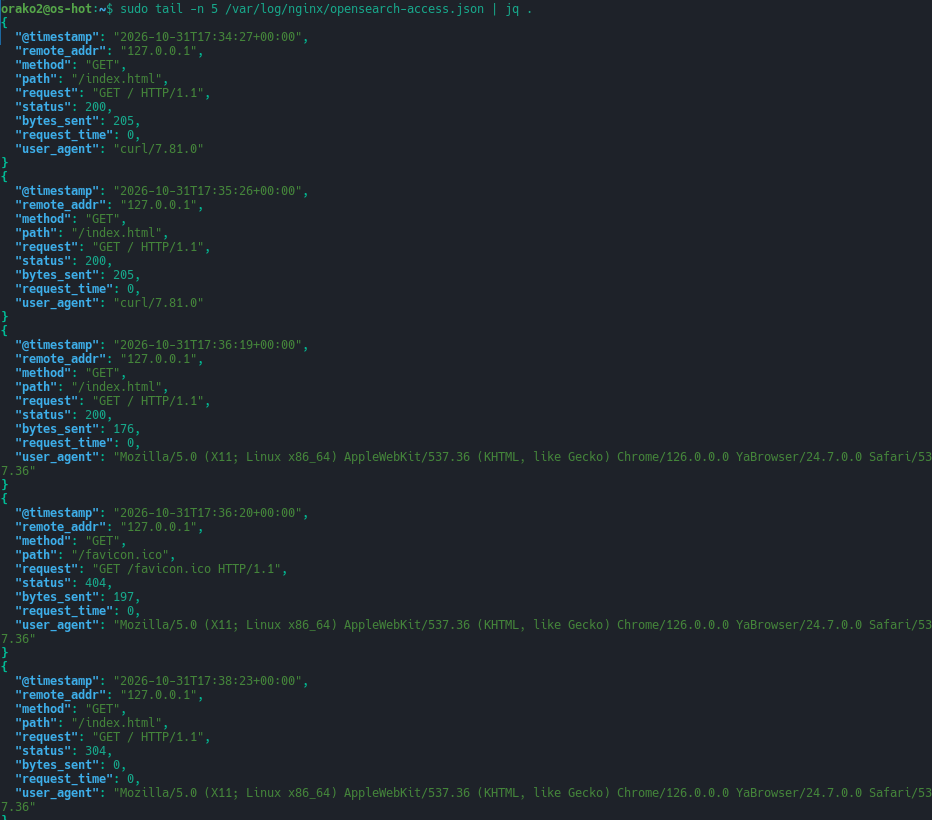


### Отправка логов через Fluent Bit

Для передачи логов выбрал **Fluent Bit**. Он достаточно легкий и подходит для чтения файлов с последующей отправкой записей в OpenSearch.

Fluent Bit использует входной плагин `tail`, который отслеживает JSON-лог Nginx. Положение чтения сохраняется в отдельной базе, чтобы после перезапуска не перечитывать весь файл заново.

Для отправки используется плагин `opensearch` с операцией `create`. Документы направляются в data stream `logs` по HTTPS с проверкой TLS-сертификата.

Подключение выполняется от пользователя `logs_writer_user`, созданного во второй части лабораторной. Таким образом, Fluent Bit не использует административные права. Пароль пользователя берется из Ansible Vault.

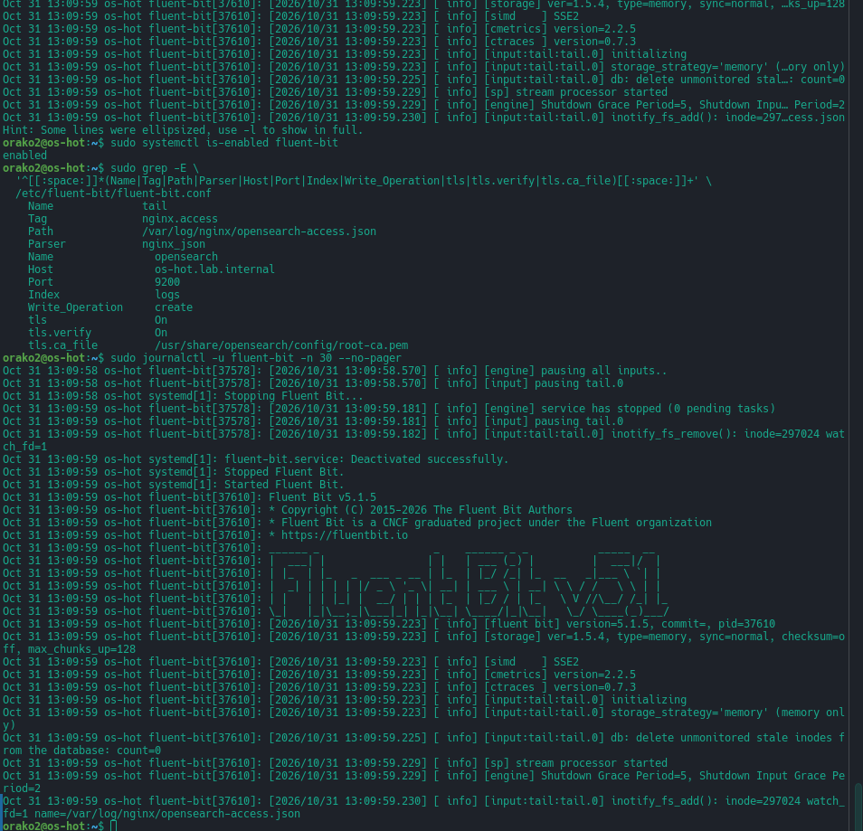

### Шаблон индекса и политика хранения

Для логов подготовил index template `logs-nginx-template`, который применяется к data stream `logs`.

В шаблоне указаны типы основных полей, включая `@timestamp`, `status`, `remote_addr` и `request_time`. Также настроено размещение новых индексов на Hot-узле через атрибут `temp: hot`.

Для управления хранением создал ISM-политику `logs-retention-10m` со следующими условиями:

| Параметр | Значение |
|---|---|
| Rollover по размеру | 1 МБ |
| Rollover по времени | 1 минута |
| Условие rollover | Любое из двух |
| Время хранения | 10 минут |
| Размещение новых индексов | Hot |
| Размещение после rollover | Warm |

После достижения 1 МБ или возраста 1 минута ISM должен выполнить rollover, создав новый backing index для записи логов. Предыдущий индекс переходит на Warm-узел, а при достижении возраста 10 минут подлежит удалению.

Для лабораторной уменьшил интервал проверки ISM до одной минуты и отключил случайную задержку. При этом удаление и rollover происходят не строго в указанную секунду, а при очередном выполнении фоновых задач ISM.

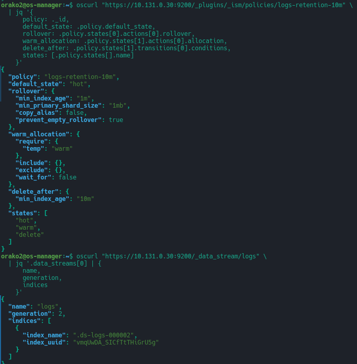

### Запуск и проверка

Развертывание третьей части вынесено в отдельный playbook:

`ansible-playbook playbooks/09-logs.yml -b --ask-become-pass --ask-vault-pass`

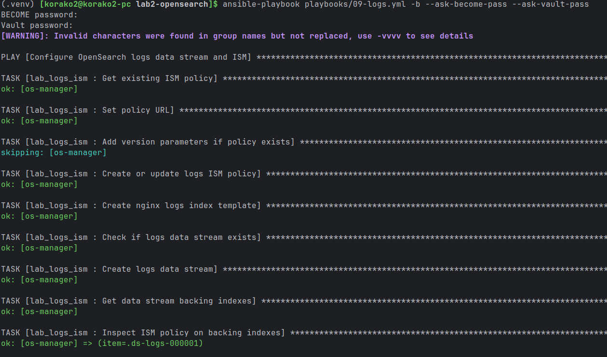
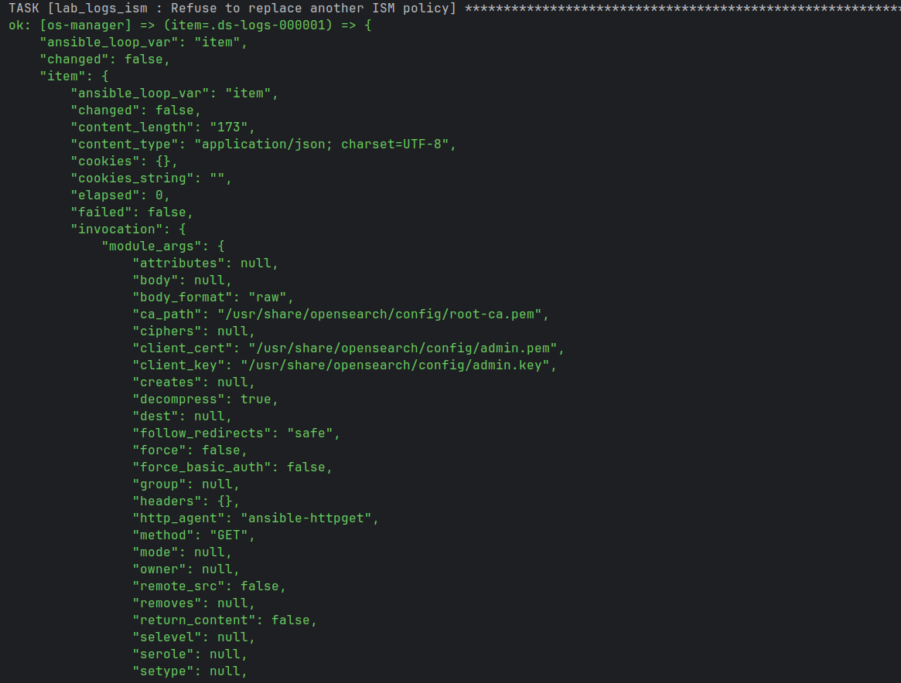
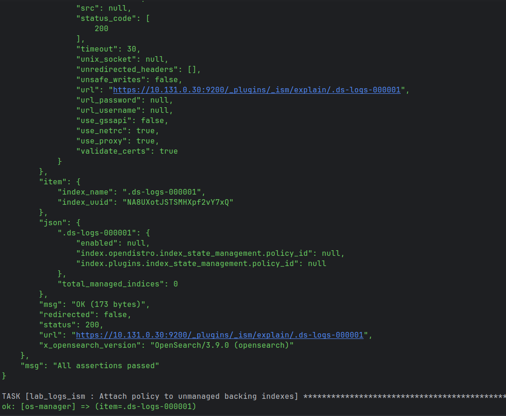
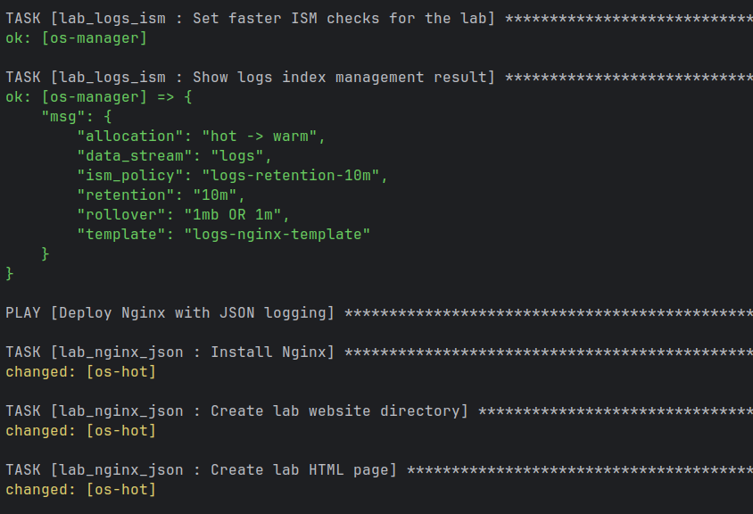
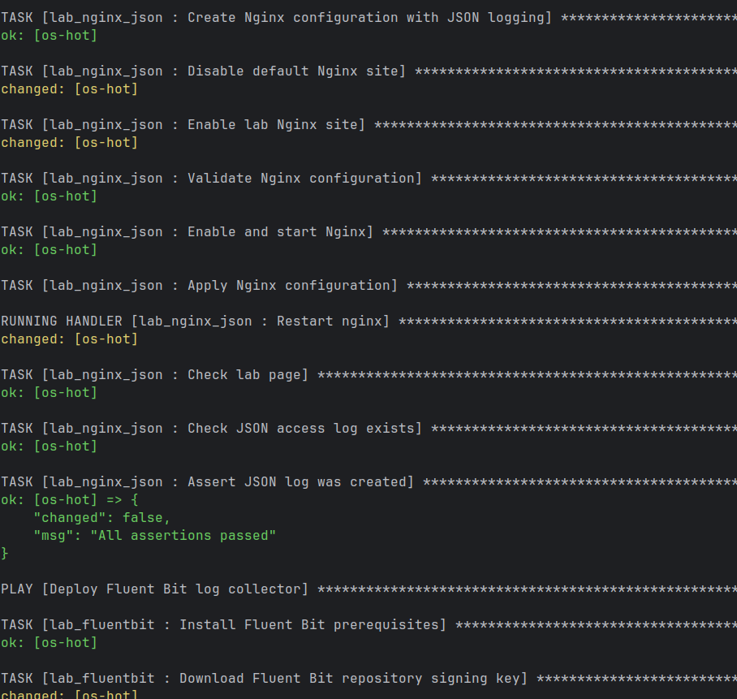
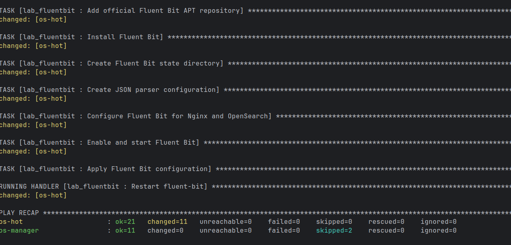


Он последовательно настраивает политику и data stream, устанавливает Nginx и запускает Fluent Bit.

Для проверки подготовил `10-logs-verify.yml`. Он генерирует HTTP-запросы к Nginx, проверяет формат JSON-лога, наличие документов в OpenSearch и параметры ISM-политики.

Дополнительно через OpenSearch REST API можно посмотреть документы в `logs`, поколения data stream и состояние backing indices с помощью `/_plugins/_ism/explain/.ds-logs-*`.

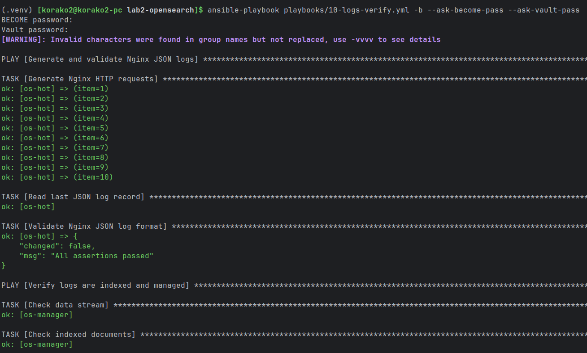
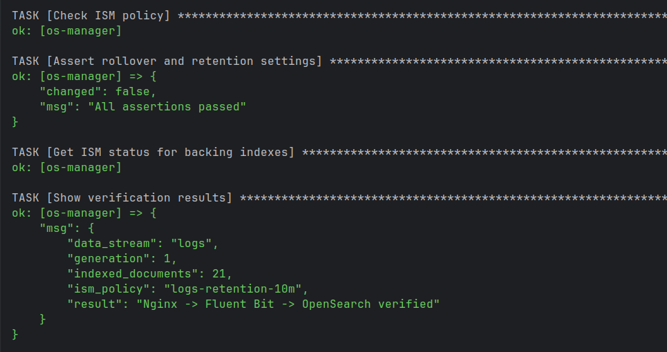
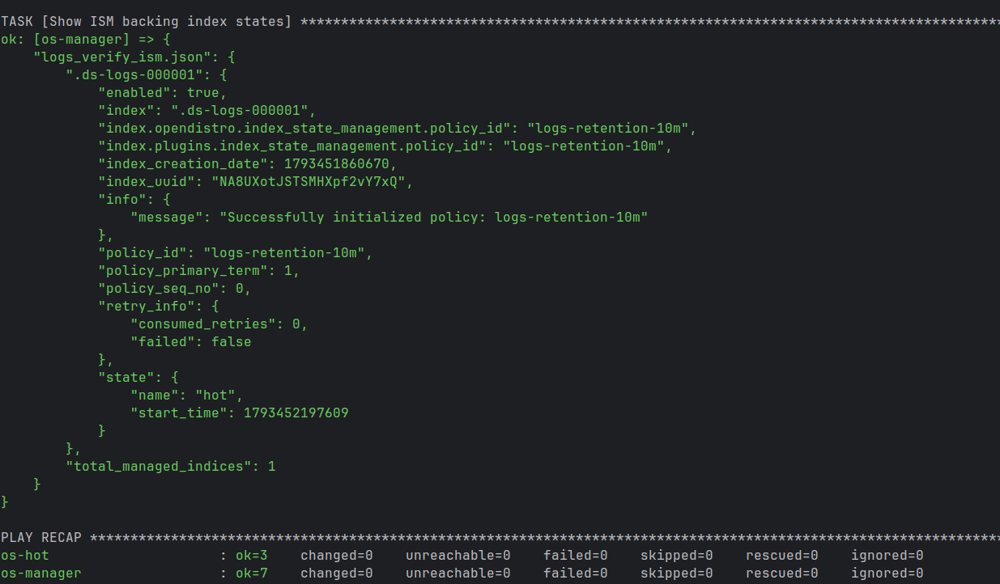


## Часть 4. Мониторинг

В четвертой части лабораторной работы нужно было настроить сбор метрик OpenSearch через Prometheus, выбрать полезные показатели состояния кластера и вывести их на дашборд Grafana. Все разворачивал через Ansible, как и в предыдущих частях.

### Настройка мониторинга

Для сбора метрик использовал связку **OpenSearch Prometheus Exporter -> Prometheus -> Grafana**.

На `os-hot` установил плагин `prometheus-exporter` версии `3.9.0.0`, совместимый с OpenSearch 3.9.0. Он предоставляет метрики через HTTPS endpoint `/_prometheus/metrics`. Настроил получение статистики сразу со всех трех узлов кластера, поэтому устанавливать плагин на каждый сервер не пришлось.

Prometheus и Grafana развернул на `os-warm`. На `os-manager` оставалось около 900 МБ доступной оперативной памяти, поэтому дополнительно нагружать его не хотелось. Кроме того, у меня был лимит ресурсов Яндекс Облака примерно в 10 ГБ ОЗУ, из-за чего приходилось довольно аккуратно распределять память между виртуальными машинами.

Prometheus собирает метрики каждые 15 секунд. Для экономии ресурсов ограничил хранение данных 24 часами и 300 МБ на диске. Для подключения к OpenSearch используется созданный во второй части пользователь `monitor_user`, которому добавил необходимые разрешения на получение метрик. Соединение работает по HTTPS с проверкой корневого CA.

Настройка выполнялась отдельным playbook:

```bash
ansible-playbook playbooks/11-monitoring.yml \
  -b --ask-become-pass --ask-vault-pass
```

Во время установки возникло несколько проблем. Сначала Ansible остановился на проверке памяти `os-warm`: доступно было 1485 МБ при заданном пороге 1500 МБ. Поскольку это был наш собственный запас, а не обязательное требование, снизил порог до 1200 МБ.

Затем OpenSearch возвращал `403 Forbidden` при обращении пользователя мониторинга к Prometheus Exporter. Пришлось дополнить разрешения роли `cluster_monitor` и повторно применить RBAC.

Еще одна проблема возникла с установкой Grafana: официальный APT-репозиторий возвращал `HTTP 403` при скачивании GPG-ключа. В итоге пришлось скачивать `.deb`-пакет Grafana на основной компьютер и передавать его на облачную ВМ через SSH. Передача большого файла занимала довольно много времени, но после этого установка успешно продолжилась.

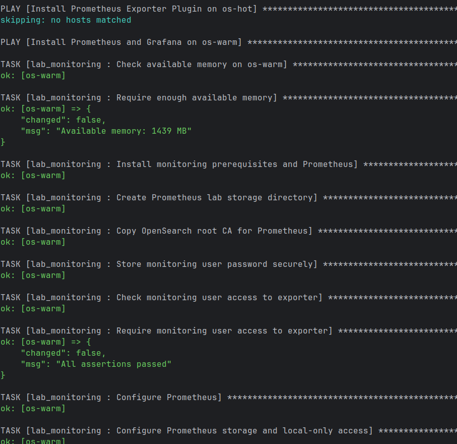
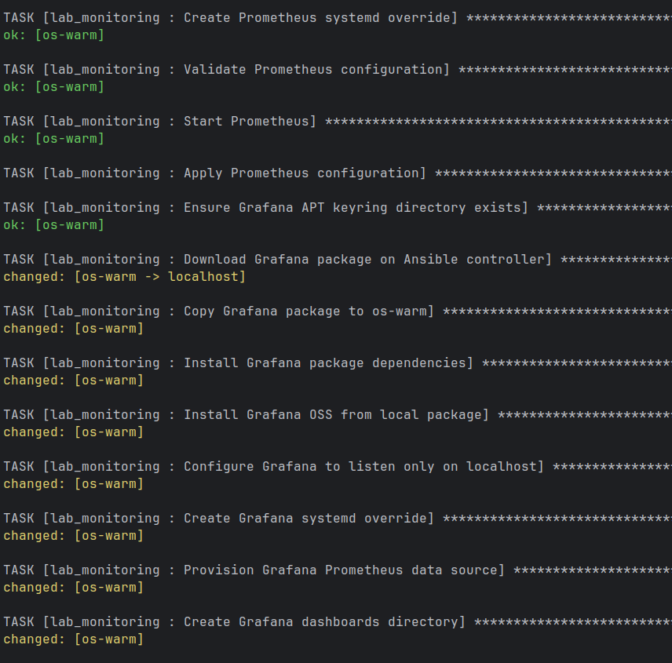
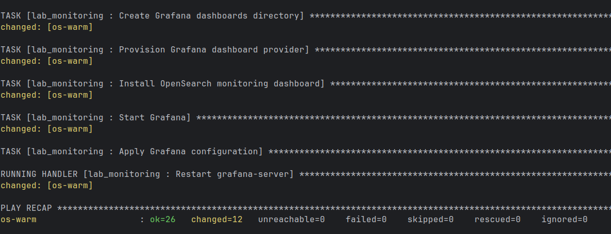

### Дашборд Grafana

Для отображения метрик создал собственный дашборд **OpenSearch Lab Monitoring**. Источник данных Prometheus и сам дашборд добавляются в Grafana автоматически через provisioning.

На дашборд вывел девять показателей:

- **Cluster health** — состояние кластера (Green, Yellow, Red).
- **Cluster nodes / Data nodes** — количество всех узлов и узлов хранения данных.
- **Active shards %** — процент активных шардов.
- **JVM Heap usage** — использование памяти JVM по каждому узлу.
- **CPU usage** — загрузка процессора по узлам.
- **Free disk** — доступное место на дисках.
- **Indexing operations/sec** — скорость индексации документов.
- **Search operations/sec** — интенсивность поисковых запросов.

Grafana доступна только локально на `os-warm`, поэтому открывал ее в браузере основного компьютера через SSH-туннель.

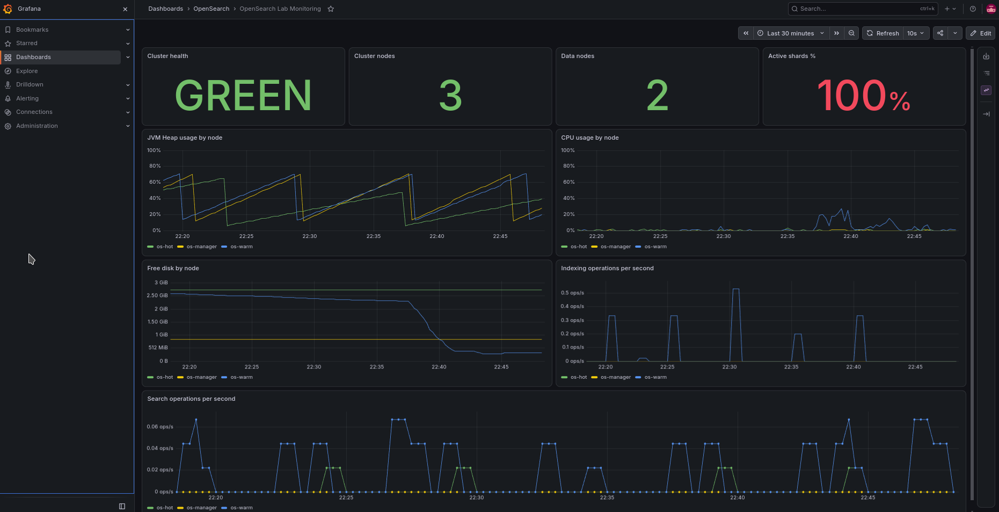

На полученном графике видно, что кластер находится в состоянии **GREEN**, все три узла доступны, два из них являются data-узлами, а активность шардов составляет **100%**.

Наиболее интересно выглядит график JVM Heap: использование памяти на узлах постепенно увеличивается примерно до 60–70%, после чего резко снижается. Это нормальная работа сборщика мусора Java (Garbage Collector), который периодически освобождает память.

Загрузка CPU в основном небольшая, хотя на `os-warm` заметны кратковременные всплески примерно до 20–30%. Также видны небольшие пики операций индексации (до 0,5 операции в секунду) и поисковых запросов (около 0,07 операции в секунду).

Отдельно обратил внимание на свободное место на `os-warm`: за время наблюдения оно уменьшилось примерно с 2,5 ГиБ до 300–400 МиБ. Это уже довольно мало и показывает, насколько сильно ограниченные ресурсы виртуальных машин влияют на эксплуатацию даже небольшого учебного кластера.

### Проверка работоспособности

Для проверки мониторинга подготовил отдельный playbook:

```bash
ansible-playbook playbooks/12-monitoring-verify.yml \
  -b --ask-become-pass
```

Он проверяет доступность Prometheus Exporter, работу Prometheus и Grafana, получение метрик OpenSearch и наличие дашборда.

В Prometheus кластер успешно определяется как `UP`, а метрика количества узлов возвращает значение `3`. Grafana также получает данные и отображает графики всех трех серверов.

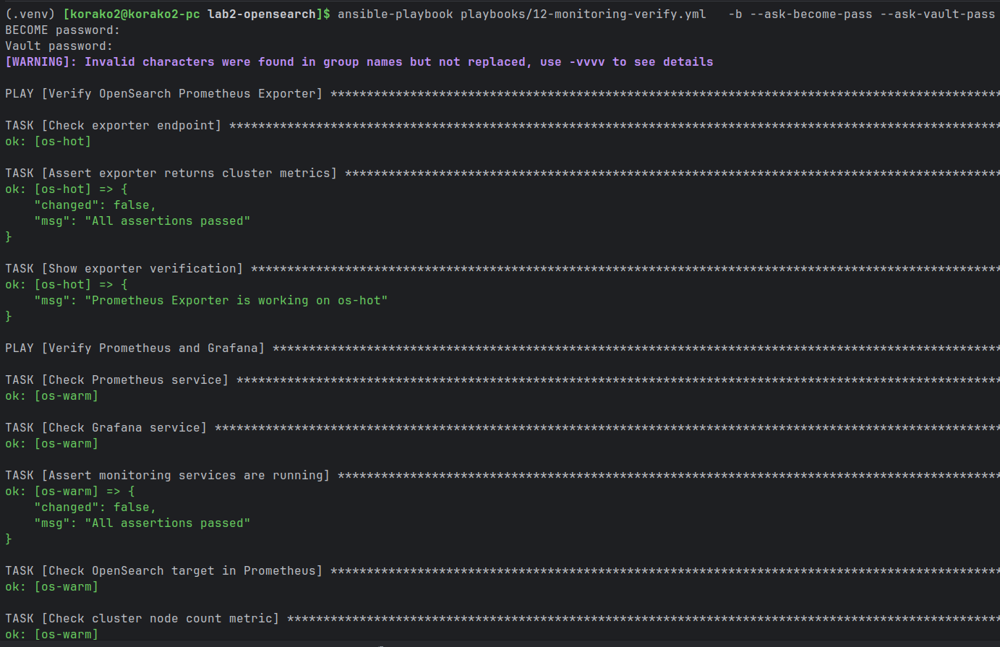
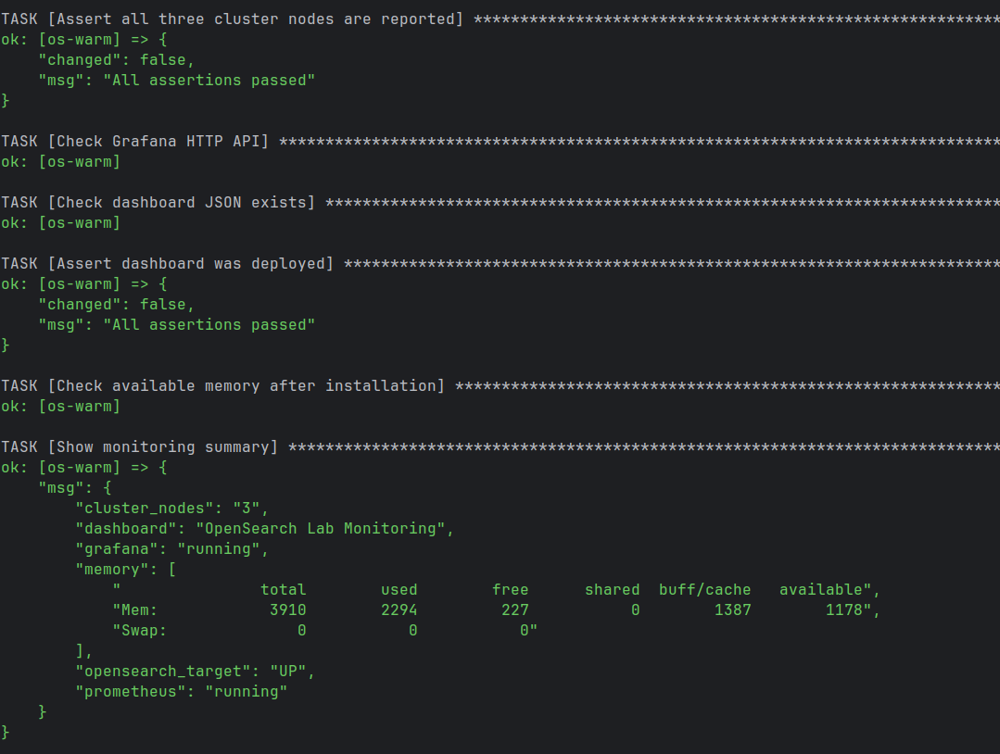

В итоге удалось настроить полноценный мониторинг OpenSearch с автоматическим развертыванием через Ansible. Теперь можно наблюдать не только за доступностью кластера, но и за его производительностью, использованием памяти, процессора и дискового пространства.

### Впечатления от лабораторной работы

В целом лабораторная получилась довольно непростой, особенно из-за постоянных проблем с ресурсами, сетью и сертификатами. Больше всего времени ушло даже не на сам OpenSearch, а на то, чтобы заставить все компоненты нормально взаимодействовать друг с другом. Зато было интересно разобраться с Hot–Warm архитектурой, TLS, ролевой моделью, Fluent Bit и управлением индексами через ISM. Отдельной головной болью оказалась проблема с запуском кластера на виртуалках на двух ПК, соединенных в локальную сеть. Почему-то узел, запущенный в VirtualBox, не мог нормально общаться с узлами в VMware, хотя пинги и SSH работали. В итоге пришлось переносить все в облако, где кластер заработал без проблем. Надо будет в свободное время попробовать еще раз запустить эту лабу локально на двух машинах, чтобы понять, в чем была проблема.
