# Лабораторная работа №2. Эксплуатация OpenSearch

## Часть 1. Развертывание

В первой части нужно было развернуть кластер OpenSearch с архитектурой Hot–Warm, настроить TLS для Transport и REST API и запустить OpenSearch Dashboards. Все делал через **Ansible, без Docker**. В итоге кластер работает на трех виртуальных машинах Ubuntu Server в Яндекс Облаке, версия OpenSearch и Dashboards **3.9.0**.

### Развертывание кластера

Кластер `opensearch-lab` состоит из трех узлов:

| Узел | Внутренний IP | Роли | Назначение |
|---|---|---|---|
| `os-hot` | `10.128.0.22` | `data`, `cluster_manager`, `ingest` | Актуальные данные, Hot |
| `os-warm` | `10.130.0.17` | `data`, `cluster_manager` | Менее актуальные данные, Warm |
| `os-manager` | `10.131.0.30` | `cluster_manager` | Управление кластером и Dashboards |

Для установки я адаптировал официальные Ansible-роли OpenSearch под свой проект (`roles/opensearch` и `roles/dashboards`). Остальную настройку вынес в отдельные роли: `lab_hot_warm`, `lab_dashboards_tls` и `lab_verify`. Адреса для SSH и внутреннего взаимодействия узлов задаются в `host_vars` через переменные окружения, поэтому после переезда в облако не пришлось переписывать всю конфигурацию. В `group_vars/all/main.yml` находятся общие параметры кластера.

Сначала проверяется inventory и Java 21+ на управляющем компьютере, она нужна для генерации сертификатов. Затем последовательно запускаются playbook:

```bash
ansible-playbook playbooks/00-check-configuration.yml
ansible-playbook playbooks/02-opensearch.yml -b --ask-become-pass
ansible-playbook playbooks/03-dashboards.yml -b --ask-become-pass
ansible-playbook playbooks/04-hot-warm.yml -b --ask-become-pass
ansible-playbook playbooks/05-dashboards-tls.yml -b --ask-become-pass
ansible-playbook playbooks/06-verify.yml -b --ask-become-pass
```

`02-opensearch.yml` устанавливает OpenSearch из архива, создает пользователя и systemd-сервис, настраивает кластер и Security Plugin. Во время установки генерируется собственный корневой CA и сертификаты узлов. Они используются для защищенного Transport-соединения на порту **9300** и HTTPS REST API на порту **9200**. Сервисы включены в автозапуск через systemd.

В `04-hot-warm.yml` узлам с данными добавляются атрибуты `node.attr.temp: hot` и `node.attr.temp: warm`. При изменении конфигурации узлы перезапускаются **по одному**, чтобы не нарушать работу кластера. Пока это именно разметка узлов по уровням хранения; правила переноса индексов будут настраиваться в следующих частях работы.

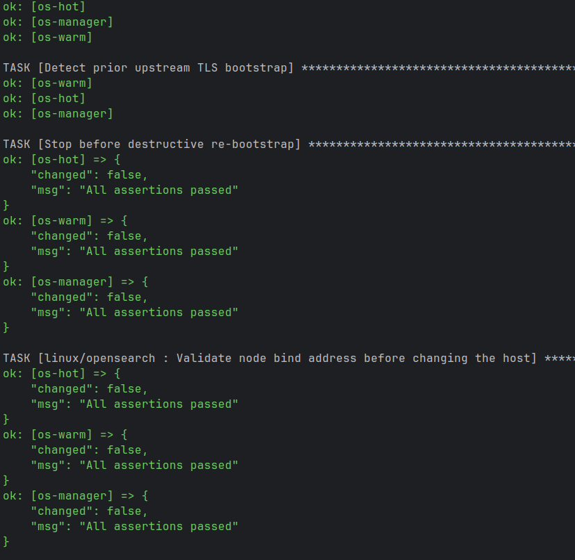
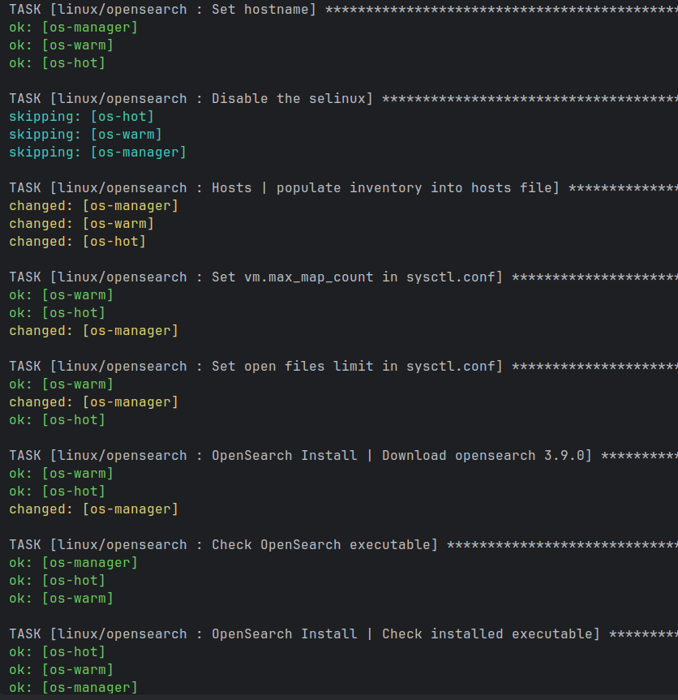
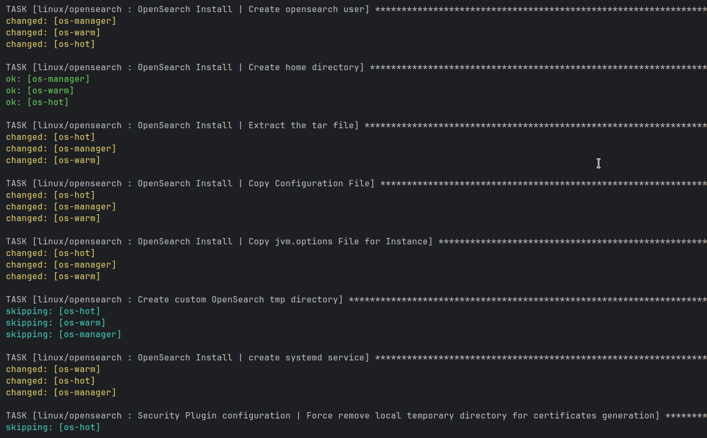
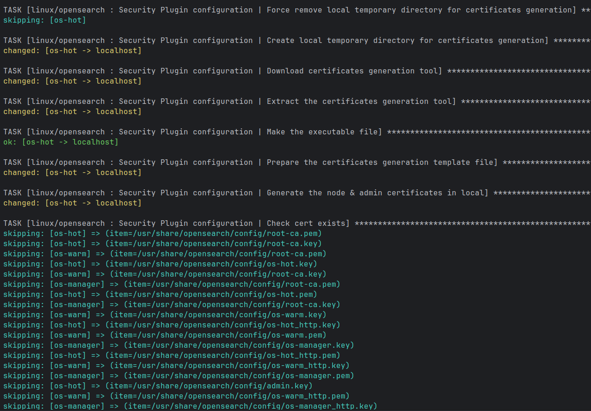
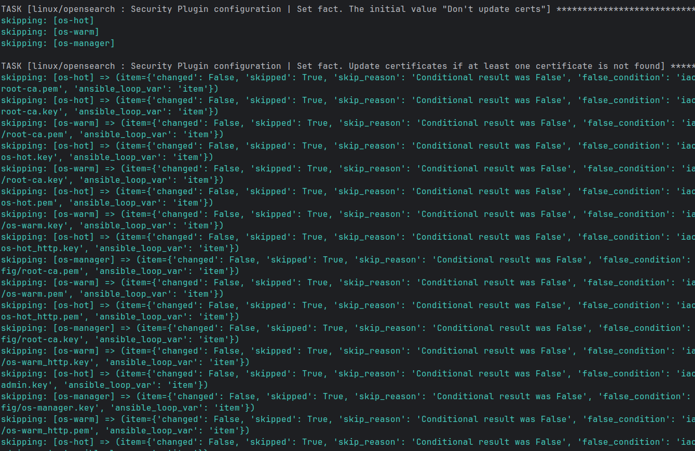
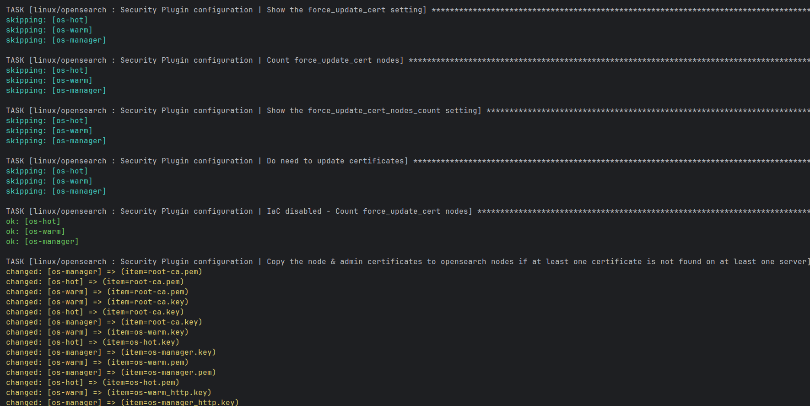
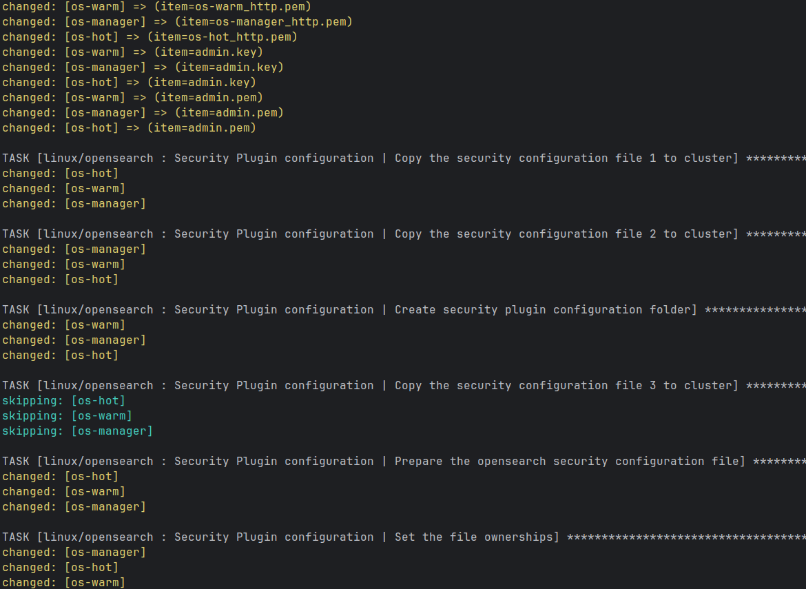
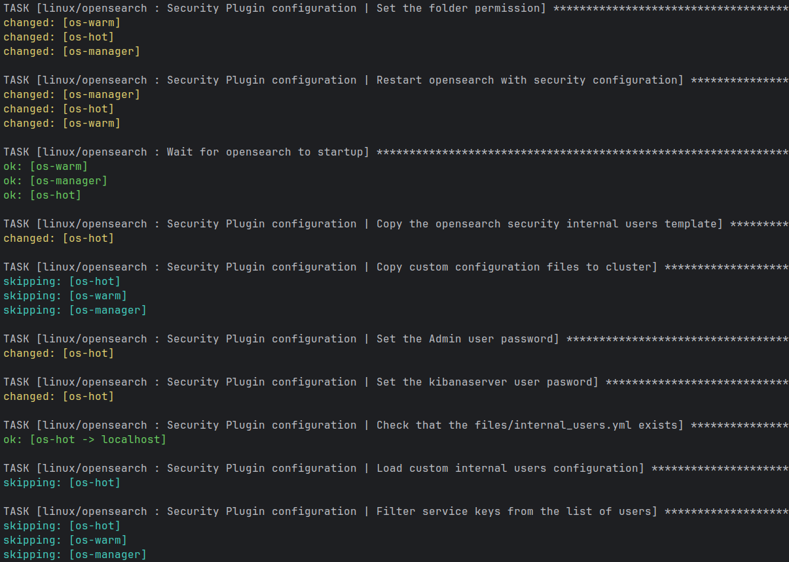
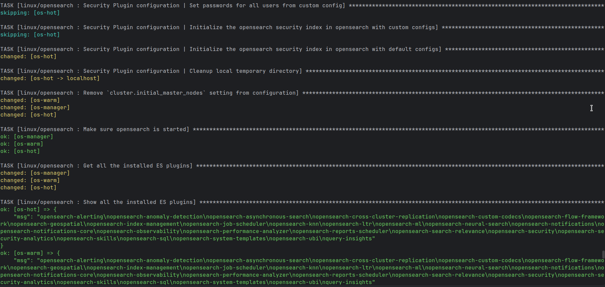
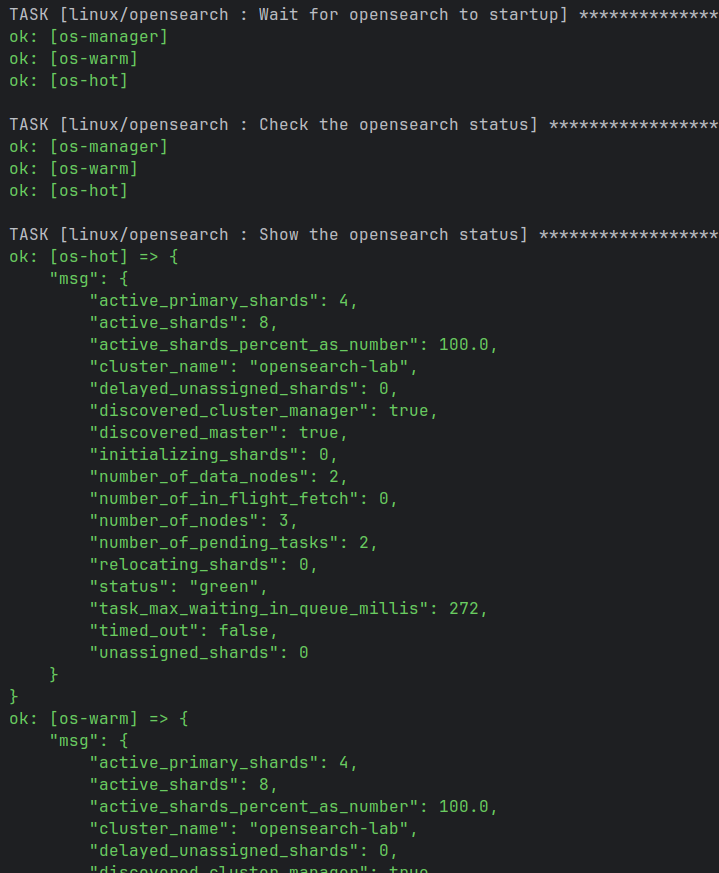
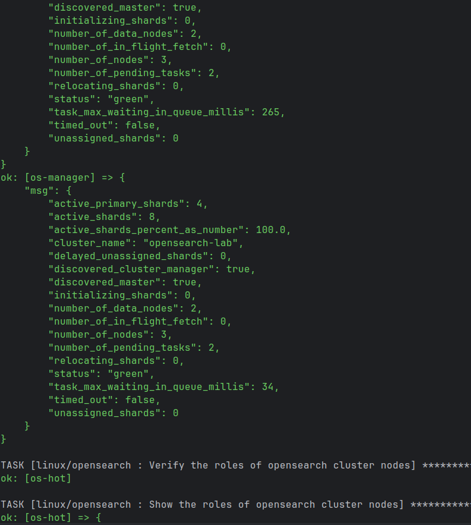
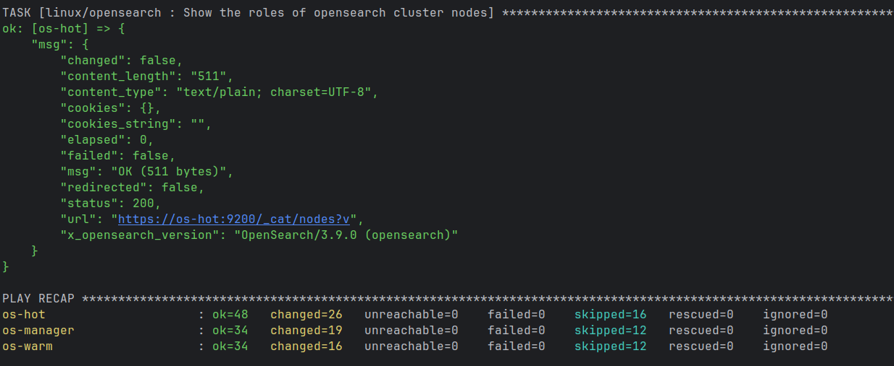

### Проблемы при настройке

Больше всего времени ушло на попытку собрать кластер локально. Сначала `os-hot` работал в VirtualBox на ноутбуке с Linux, а `os-warm` и `os-manager` в VMware на втором ноутбуке с Windows. При этом виртуалки нормально пинговались, подключались по SSH, порты были доступны, а TLS-проверки проходили. Но именно **кластер OpenSearch не собирался**: `os-hot` видел только себя, а при попытке присоединиться к остальным узлам возникали ошибки Transport handshake и `Connection reset`.

Из-за этого зависала команда `securityadmin.sh`, которая ждала готовности кластера для загрузки настроек безопасности. За время отладки пришлось исправлять IP и `/etc/hosts`, проверять сертификаты, логи Java и OpenSearch и даже сравнивать сетевые пакеты через `tcpdump`. Однозначную причину сброса соединений между двумя ноутбуками так и не удалось установить.

Параллельно выяснилось, что для нормальной работы каждой ВМ желательно выделить около **4 ГБ ОЗУ**, а один ноутбук все три машины одновременно не тянул. Поэтому я решил отказаться от локального варианта и **перенести кластер в Яндекс Облако**. После настройки облачных IP-адресов и SSH все три узла смогли объединиться в один кластер.

### OpenSearch Dashboards и HTTPS

Dashboards установлен на `os-manager` и работает на порту **5601**. В `05-dashboards-tls.yml` для него создается отдельный серверный сертификат, подписанный тем же CA, включается `server.ssl.enabled: true`, проверка сертификата OpenSearch (`opensearch.ssl.verificationMode: full`) и защищенные cookies.

Так как на ВМ нет графического интерфейса, страницу Dashboards я открыл в браузере своего ноутбука через **SSH-туннель** на локальный порт `15601`. Сначала браузер ругался на сертификат: он не доверял учебному CA и я открывал сайт через `localhost`. В итоге добавил публичный `root-ca.pem` в доверенные и настроил локальное имя `os-manager.lab.internal`. После этого Dashboards открылся по HTTPS без ошибки сертификата.

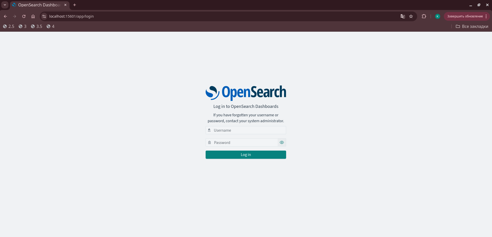

### Проверка результата

Состав кластера проверял через `/_cat/nodes?v`: в ответе видны **все три узла**.

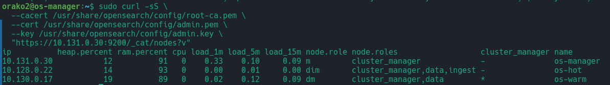

Через `/_cat/nodeattrs?v` проверил атрибуты: у `os-hot` — `temp: hot`, у `os-warm` — `temp: warm`.

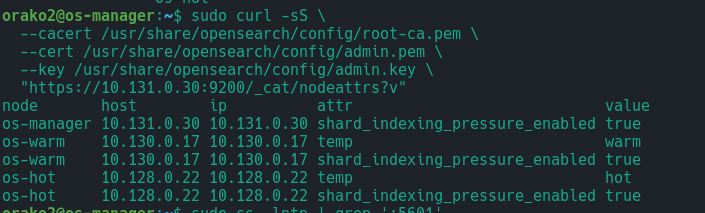

Последний playbook `06-verify.yml` проверяет состояние кластера по HTTPS с проверкой CA, число узлов, атрибуты Hot/Warm и доступность Dashboards. Он завершился без ошибок и показал:

```text
cluster: opensearch-lab
status: green
total_nodes: 3
data_nodes: 2
dashboards_http_status: 302
```

Код `302` здесь нормальный: Dashboards перенаправляет на страницу авторизации. В итоге **все требования первой части выполнены**.

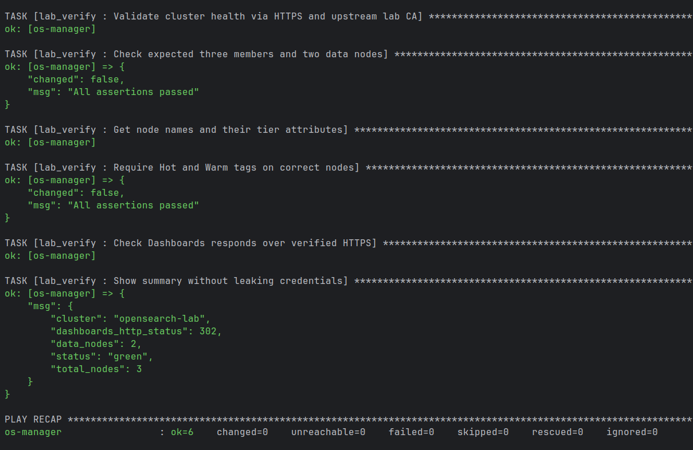

## Часть 2. Ролевая модель

Во второй части лабораторной работы нужно было создать три роли с разными правами доступа и трех пользователей, которым эти роли будут назначены. Все настраивалось через Ansible с использованием **OpenSearch Security REST API**, без переустановки или перезапуска кластера.

Для этого я создал отдельную роль `roles/rbac` и два playbook: `07-rbac.yml` для настройки пользователей и ролей и `08-rbac-verify.yml` для проверки их прав.

### Создание ролей

Были подготовлены три роли:

| Роль | Назначение |
|---|---|
| `logs_writer` | Запись документов только в data stream `logs` |
| `logs_reader` | Чтение индексов, соответствующих шаблону `logs*` |
| `cluster_monitor` | Получение состояния и метрик кластера и его узлов |

Для `logs_writer` используются разрешения `indices:data/write/index` и `indices:data/write/bulk*`. Роль предназначена для добавления документов в поток логов, без прав на удаление индексов или изменение настроек кластера.

Роль `logs_reader` получает группу разрешений `read` для индексов `logs*`, а `cluster_monitor` — только необходимые права `cluster:monitor/health`, `cluster:monitor/stats` и `cluster:monitor/nodes/stats`.

Роли создаются через запросы `PUT` к Security REST API:

```text
/_plugins/_security/api/roles/<role_name>
```

Для подключения Ansible использует существующие сертификаты администратора `admin.pem`, `admin.key` и корневой `root-ca.pem`. Таким образом, управление безопасностью выполняется через HTTPS с проверкой сертификатов.

### Создание пользователей

Для каждой роли был предусмотрен отдельный пользователь:

| Пользователь | Роль |
|---|---|
| `logs_writer_user` | `logs_writer` |
| `logs_reader_user` | `logs_reader` |
| `monitor_user` | `cluster_monitor` |

Пользователи создаются через `PUT /_plugins/_security/api/internalusers/<username>`. При создании каждому сразу назначается соответствующая роль через `opendistro_security_roles`.

Пароли не хранятся в открытом виде в Ansible-ролях. Для них используется **Ansible Vault**, а в задачах создания пользователей установлен `no_log: true`, чтобы пароли не попадали в вывод playbook.

Настройка запускается командой:

```bash
ansible-playbook playbooks/07-rbac.yml \
  -b --ask-become-pass --ask-vault-pass
```

При первом запуске роли создались успешно, но при создании пользователей возникла проблема: два запроса вернули ошибку `HTTP 404`, а один завершился успешно. Из-за `no_log: true` подробности ошибки были скрыты. Для диагностики предусмотрен отдельный вывод HTTP-статуса и сообщения API без отображения паролей.

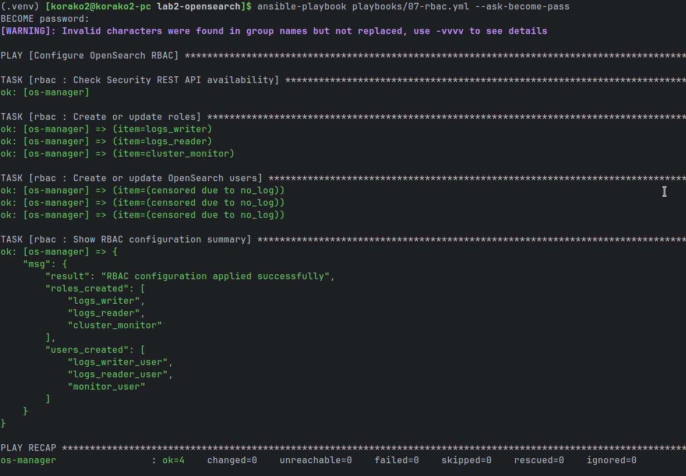

### Проверка разграничения доступа

Для проверки был подготовлен отдельный playbook:

```bash
ansible-playbook playbooks/08-rbac-verify.yml \
  -b --ask-become-pass --ask-vault-pass
```

Он использует API `/_plugins/_security/authinfo`, чтобы проверить аутентификацию пользователей и назначенные им роли.

Дополнительно предусмотрены запросы к `/_cluster/health`, `/_cluster/stats` и `/_nodes/stats`. Пользователь `monitor_user` должен успешно получать эти метрики, а пользователям чтения и записи доступ к статистике кластера должен быть запрещен с кодом `403 Forbidden`.

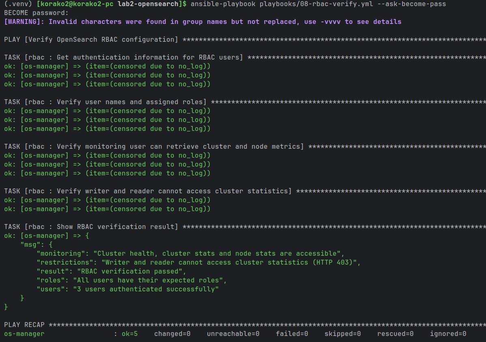

Таким образом, во второй части была подготовлена ролевая модель OpenSearch и автоматизированные сценарии ее настройки и проверки. Основные разрешения разделены между записью логов, чтением и мониторингом, а пароли вынесены в Ansible Vault. На момент последнего запуска оставалось разобраться с ошибкой создания двух пользователей и завершить проверку их доступа.