# Лабораторная работа №3. Эксплуатация Redis

## Часть 1. Выбор сценария и архитектура

Для этой лабораторной я выбрал сценарий ограничения частоты запросов (Rate Limiter). В качестве примера сделал небольшое API каталога товаров.

Идея заключается в том, что каждый клиент может отправить не более 20 запросов за любые 10 секунд. Если лимит превышен, приложение не возвращает список товаров, а отвечает кодом `429 Too Many Requests`. Когда старые запросы выходят за пределы этого окна, клиент снова может пользоваться API.

### Требования к системе

| Требование | Как реализовал |
|---|---|
| Ограничение частоты запросов | Sliding Window Log, 20 запросов за 10 секунд |
| Независимые лимиты клиентов | Отдельный ключ Redis для каждого X-Client-ID |
| Корректная работа при параллельных запросах | Атомарный Lua-скрипт |
| Очистка устаревших данных | Удаление записей за пределами окна и TTL ключей |
| Недоступность Redis | Приложение возвращает HTTP 503 вместо пропуска запроса без проверки |
| Развертывание | Ansible и Docker Compose |
| Наблюдение за работой | Prometheus, Redis Exporter и Grafana |

Для идентификации клиента использую заголовок X-Client-ID. В данной лабе мне показалось, что этого достаточно, не хотелось ее усложнать, но в реальном сервисе я бы привязал лимит к идентификатору авторизованного пользователя, иначе клиент может просто менять значение заголовка и обходить ограничение.

### Архитектура

Весь стенд был размещен на одной виртуальной машине Ubuntu Server в Яндекс Облаке. Использовал Docker Compose, а развертывание и настройку Docker автоматизировал через Ansible.

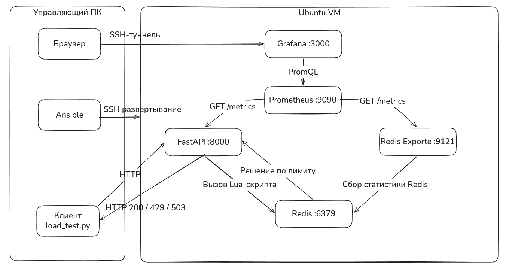

- **FastAPI** принимает HTTP-запросы, обращается к Redis и возвращает клиенту результат.
- **Redis** хранит историю разрешенных запросов и выполняет алгоритм ограничения.
- **Redis Exporter** получает метрики Redis и предоставляет их в формате Prometheus.
- **Prometheus** собирает метрики приложения и базы данных.
- **Grafana** отображает собранные метрики на дашборде.

Для контейнеров создал две сети: внутреннюю `backend`, в которой находятся Redis, API и Redis Exporter, и `monitoring`, через которую работает система мониторинга. Порт Redis наружу не пробрасывал. API, Grafana и Prometheus доступны на локальных портах виртуальной машины, а с основного компьютера подключаюсь к ним через SSH-туннель.

## Часть 2. Развертывание

### Настройка Ansible и Docker

Для этой лабы достаточно одного playbook `ansible/site.yml`. Он устанавливает Docker Engine и Compose V2, настраивает зеркала Docker Hub, копирует исходники и конфигурации на виртуальную машину, формирует `.env`, собирает приложение и запускает контейнеры. В конце проверяется доступность API и его подключение к Redis через `/health/ready`.

Пароли Redis и Grafana хранятся в зашифрованном файле `ansible/group_vars/secrets.yml` с помощью Ansible Vault. Файл `.env` на сервере создается из `ansible/env.j2` с правами `0600`.

Развертывание запускалось следующим образом:

```bash

ansible-playbook -i ansible/inventory.ini ansible/site.yml --ask-vault-pass
```

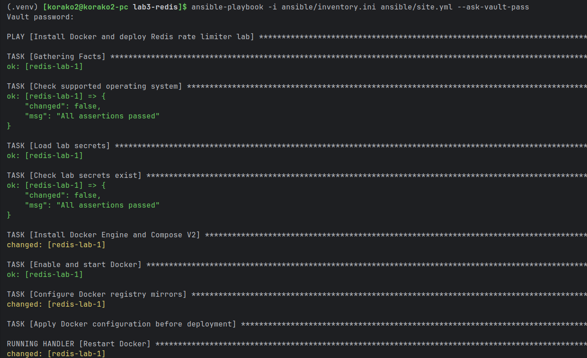

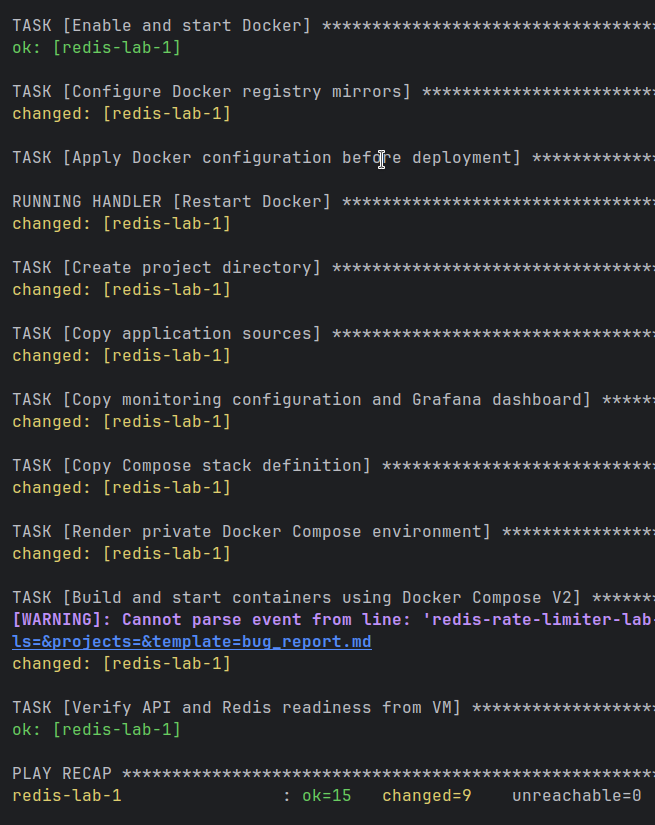

В итоге playbook дошел до последней проверки, и она завершилась успешно.

### Проблемы при настройке

Как и в предыдущей лабе, часть времени ушла вообще не на саму базу данных, а на проблемы с инфраструктурой. Сначала при попытке скачать GPG-ключ официального репозитория Docker с `download.docker.com` получал `Network is unreachable`. При этом интернет на виртуальной машине был: DNS работал, а Docker иногда даже отвечал кодом 200. Повторные запросы, в том числе через IPv4, снова завершались тайм-аутом.

В итоге решил не мучиться с официальным репозиторием и устанавливать Docker из стандартного репозитория Ubuntu (`docker.io`, `docker-compose-v2`, `docker-buildx`).

После этого возникла еще одна проблема: Docker установился, но при скачивании образа Grafana с `registry-1.docker.io` снова получал `i/o timeout`. Из-за этого прерывалась загрузка остальных образов и весь стек не запускался.

Решил эту проблему с помощью зеркал Docker Hub. В Ansible добавил создание `/etc/docker/daemon.json` со списком зеркал Timeweb, GitVerse и Yandex Cloud, а также перезапуск Docker при изменении конфигурации. После этого удалось развернуть стек. Какое конкретно зеркало отдало каждый образ, отдельно не проверял.

### Конфигурация Redis

| Параметр | Значение |
|---|---|
| Docker-образ | `redis:8.2-alpine` |
| Порт внутри сети | 6379 |
| Максимальный объем памяти | 128 МБ |
| Политика вытеснения | `noeviction` |
| Хранилище | Docker volume `redis_data` |
| Аутентификация | Пароль из Ansible Vault |

Выбрал `noeviction`, чтобы Redis не удалял произвольные ключи с историей запросов при нехватке памяти: иначе отдельный клиент мог бы неожиданно получить новый лимит. При невозможности записать данные приложение должно возвращать 503. 

## Часть 3. Реализация приложения и Rate Limiter

### Что хранится в Redis

Приложение написано на Python с использованием FastAPI и библиотеки `redis`. В `app/src/main.py` находится HTTP API, а в `app/src/limiter.py` - класс `RedisRateLimiter`, который работает с Redis и вызывает Lua-скрипт.

В Redis хранятся не сами товары, а историю разрешенных запросов каждого клиента. Для этого использую **Sorted Set**.
Sorted Set удобно использовать здесь потому, что можно удалять элементы по диапазону времени, быстро получать количество запросов и находить самый старый из них.

### Алгоритм Sliding Window Log

Сначала рассматривался простой счетчик запросов за фиксированный интервал, но в итоге было выбрано скользящее окно. В отличие от фиксированного окна оно не привязано к конкретному началу минуты или десятисекундного интервала, а каждый раз учитывает последние 10 секунд относительно текущего момента.

При каждом запросе Lua-скрипт выполняет следующую последовательность:

1. Получает текущее время на стороне Redis (`TIME`).
2. Удаляет записи, которые вышли за пределы окна (`ZREMRANGEBYSCORE`).
3. Считает оставшиеся запросы (`ZCARD`).
4. Если их меньше 20, добавляет новый запрос (`ZADD`) и устанавливает TTL ключа на 10 секунд (`PEXPIRE`).
5. Если лимит уже исчерпан, не добавляет запись и рассчитывает по самому старому запросу (`ZRANGE`), когда освободится место в лимите.

Python получает из Redis решение, число оставшихся запросов и время до освобождения места в лимите.

Lua здесь нужен для атомарности. Например, если клиент уже отправил 19 запросов и затем одновременно отправляет еще два, оба запроса не должны увидеть счетчик 19 и пройти. Redis выполняет скрипт целиком без вмешательства других команд между проверкой и добавлением записи. Заодно не нужно отправлять каждую Redis-команду из Python отдельно.

TTL нужен для удаления ключей клиентов, которые перестали пользоваться сервисом. После последнего разрешенного запроса ключ может автоматически исчезнуть через 10 секунд. Это позволяет не хранить историю всех когда-либо обращавшихся клиентов.

### Проверка приложения

Для проверки сначала обратился к `/health/live` и `/health/ready`, а затем к каталогу товаров:

```bash
curl http://127.0.0.1:8000/health/live
curl http://127.0.0.1:8000/health/ready

curl -i -H "X-Client-ID: user1" \
    http://127.0.0.1:8000/api/items
```

На скриншоте видно, что приложение возвращает HTTP 200, список из двух товаров и заголовки с информацией об ограничении:

- `X-RateLimit-Limit: 20` — общий лимит.
- `X-RateLimit-Remaining: 19` — сколько запросов еще можно отправить.
- `X-RateLimit-Reset: 10` — через сколько секунд освободится место в текущем окне.

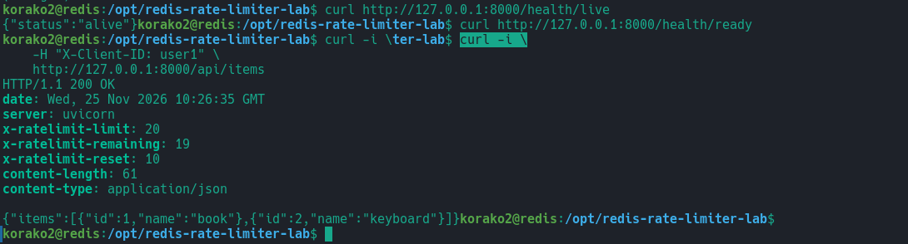

Затем отправил 25 запросов от одного клиента:

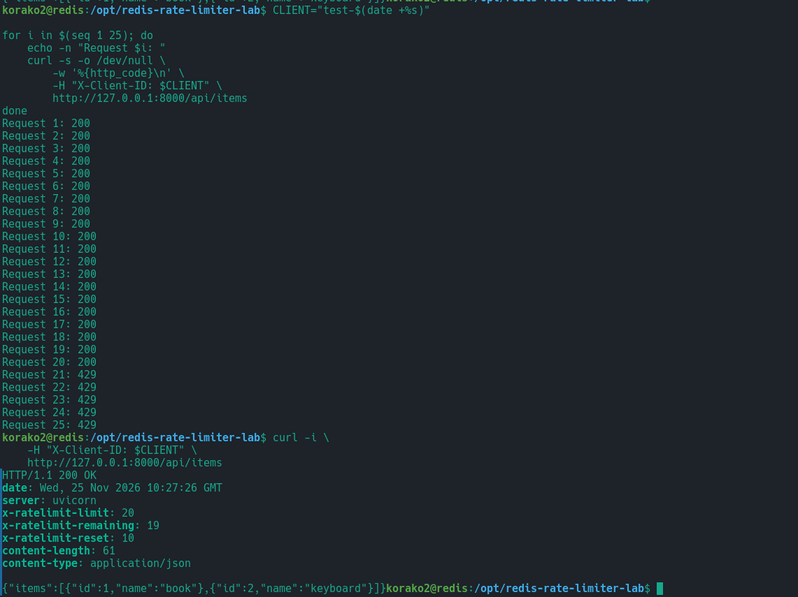

Первые 20 запросов вернули `200`, следующие 5 - `429`. При повторном обращении после истечения окна снова получил `200`, причем лимит был уже практически полностью свободен (`remaining: 19`). Таким образом, на ручной проверке ограничитель отработал именно так, как и задумывалось.

## Часть 4. Нагрузочное тестирование

### Генератор нагрузки

Для нагрузочного тестирования был сделан отдельный скрипт `loadtest/load_test.py` на Python с использованием `asyncio` для конкурентного выполнения запросов и `httpx.AsyncClient` для HTTP-соединений. Через `asyncio.Semaphore` было ограничено количество запросов, выполняющихся одновременно.

Можно задавать общее число запросов, количество логических клиентов и уровень конкурентности. При каждом запуске генерируется новый префикс идентификаторов клиентов, поэтому новый тест не наследует их лимиты из предыдущего.

Скрипт считает HTTP-коды, число ошибок соединения, общую скорость выполнения и задержки (`mean`, `p50`, `p95`, `p99`). Результаты сохраняются в JSON в папку `results/`. HTTP 429 считаю отдельно от ошибок соединения, так как для Rate Limiter это нормальный и ожидаемый ответ.

Тесты запускались с основного компьютера через SSH-туннель до API на виртуальной машине:

### Тест 1. Один клиент, 300 запросов

```bash
python loadtest/load_test.py --requests 300 --clients 1 --concurrency 50 --out results/test1.json
```

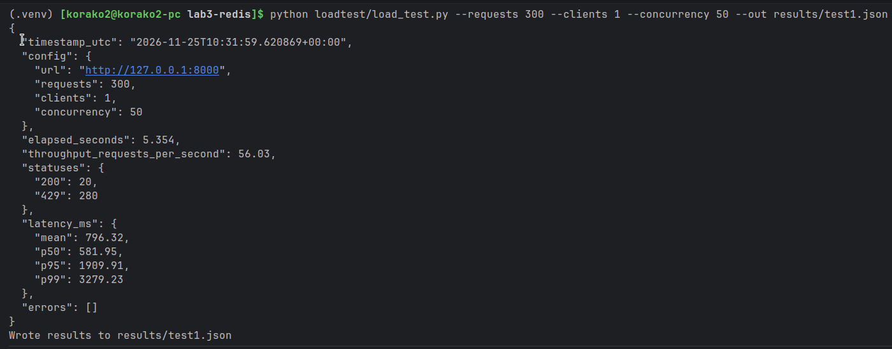

Из 300 запросов прошли ровно 20, остальные 280 заблокированы. Тест занял 5,354 секунды, то есть все запросы уложились в одно десятисекундное окно. Ошибок соединения не было. Это особенно хорошо показывает, что ограничитель корректно работает и при параллельных запросах, а не только при последовательной отправке через `curl`.

### Тест 2. Сто клиентов, 300 запросов

```bash
python loadtest/load_test.py --requests 300 --clients 100 --concurrency 50 --out results/test2.json
```

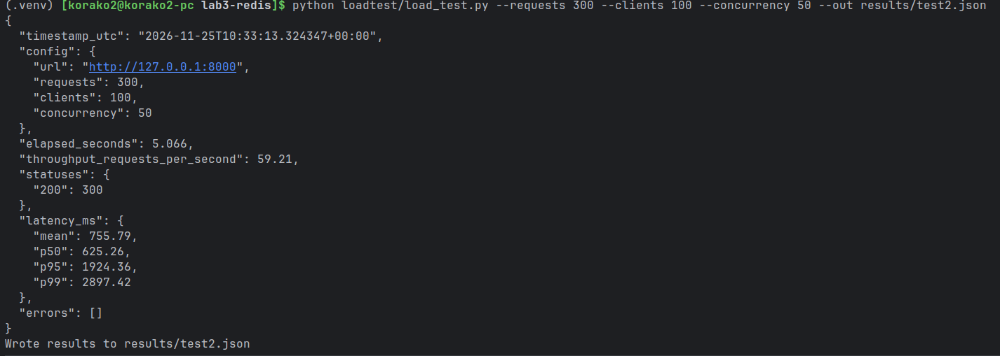

На каждого клиента приходится по три запроса. Все 300 запросов прошли без блокировок и ошибок. Получается, что общий поток запросов от множества клиентов не исчерпывает лимит каждого из них. Для каждого клиента ведется свой учет.

### Тест 3. Сто клиентов, 3000 запросов

```bash
python loadtest/load_test.py --requests 3000 --clients 100 --concurrency 100 --out results/test3.json
```

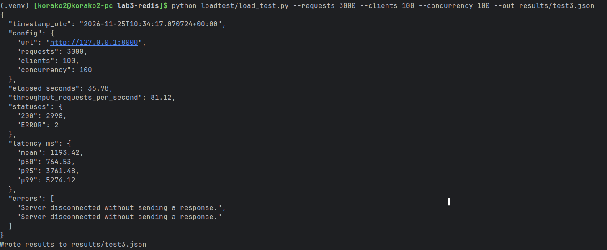

Этот тест оказался интереснее. Изначально ожидал увидеть блокировки, так как на каждого клиента приходилось по 30 запросов при лимите 20. Но тест выполнялся почти 37 секунд, а не 10, поэтому старые запросы успевали выходить из окна. Средняя интенсивность составила около 8 запросов за 10 секунд на клиента, хотя среднее значение само по себе не исключает кратковременных всплесков.

В итоге получил 2998 ответов HTTP 200, ни одного 429 и две ошибки `Server disconnected without sending a response`. Это означает, что соединение было закрыто до получения HTTP-ответа. Точную причину по этим данным установить не удалось. Возможно, сказалась конкурентная нагрузка или работа SSH-туннеля, но утверждать, что проблема именно в Redis, оснований нет.

### Тест 4. Десять клиентов, 3000 запросов

```bash
python loadtest/load_test.py --requests 3000 --clients 10 \
    --concurrency 100 --out results/test4.json
```

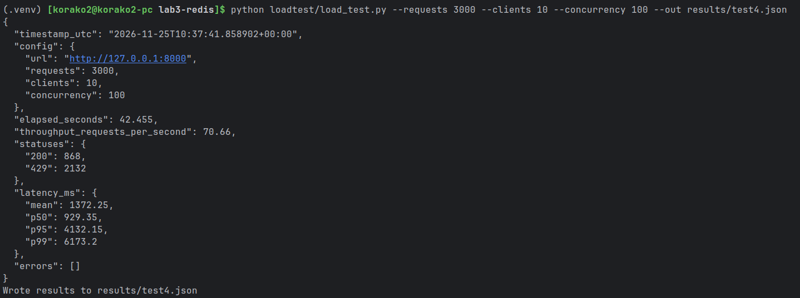

После третьего теста решил уменьшить количество клиентов, оставив количество запросов и конкурентность прежними. Теперь на одного клиента приходилось по 300 запросов. Разрешено 868, заблокировано 2132 (около 71,1%). Ошибок соединения не было.

### Тест 5. Один клиент, 3000 запросов

```bash
python loadtest/load_test.py --requests 3000 --clients 1 --concurrency 100 --out results/test5.json
```

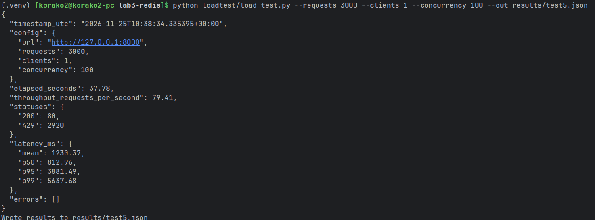

В последнем из основных тестов все 3000 запросов отправлял один клиент. За 37,78 секунды прошло 80 запросов, остальные 2920 (около 97,3%) заблокированы. То, что прошло больше 20 запросов за весь тест, нормально: ограничение действует на скользящее окно длиной 10 секунд, а не на все время работы приложения.

### Продолжительная нагрузка

Чтобы посмотреть на систему в Grafana не только во время коротких всплесков, запустил повторяющиеся тесты с паузой две секунды между итерациями:

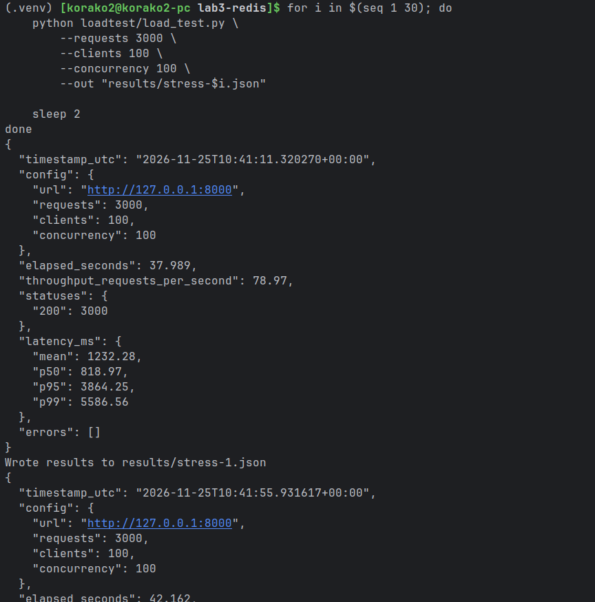

В сохранившихся результатах есть первые три итерации:

| Показатель | Итерация 1 | Итерация 2 | Итерация 3 |
|---|---:|---:|---:|
| Запросы | 3000 | 3000 | 3000 |
| HTTP 200 | 3000 | 2999 | 2998 |
| HTTP 429 | 0 | 0 | 0 |
| Ошибки соединения | 0 | 1 | 2 |
| Время, с | 37,989 | 42,162 | 38,663 |
| RPS | 78,97 | 71,15 | 77,59 |
| Средняя задержка, мс | 1232,28 | 1360,11 | 1256,51 |
| p95, мс | 3864,25 | 4343,22 | 3787,70 |

Суммарно в этих трех итерациях отправлено 9000 запросов, из которых 8997 завершились кодом 200, а три — ошибкой соединения. Это показывает, что ошибки из третьего теста не были единичным случаем, хотя возникали довольно редко. При этом ответов 503 не наблюдалось.

## Часть 5. Мониторинг

### Настройка Prometheus и Redis Exporter

Для мониторинга использовал связку **Redis Exporter -> Prometheus -> Grafana**, а в приложении дополнительно настроил собственные метрики через библиотеку `prometheus_client`.

Prometheus опрашивает оба источника каждые 5 секунд:

- `api:8000/metrics` — количество HTTP-запросов, их статусы и задержки, решения ограничителя и длительность операций с Redis.
- `redis_exporter:9121/metrics` — состояние Redis, использование памяти, соединения и другие внутренние показатели.

Данные Prometheus хранятся семь дней. Grafana подключается к нему автоматически через provisioning, дашборд также загружается при развертывании, вручную импортировать JSON не нужно.

На странице Targets оба источника метрик находятся в состоянии `UP`.

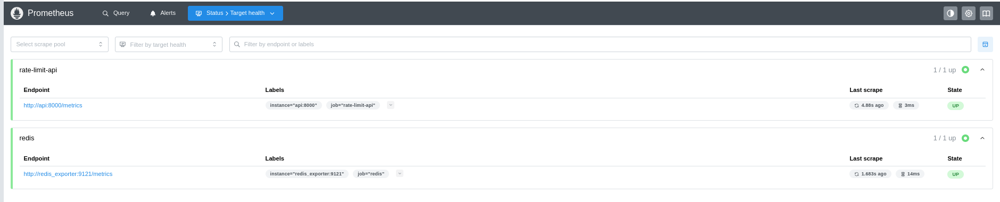

### Дашборд Grafana

Для визуализации сделал дашборд из 11 панелей:

| Панель | Что показывает и зачем нужна |
|---|---|
| Redis availability | Доступна ли сама база Redis |
| API request rate | Интенсивность запросов к каталогу |
| Rejected requests, % | Какая доля запросов блокируется |
| Accepted vs blocked requests/s | Как меняется скорость разрешенных и заблокированных запросов |
| API responses by status/s | Распределение HTTP-кодов ответов |
| API p95 latency | Задержка обработки запросов внутри приложения |
| Redis rate limiter p95 latency | Задержка вызова Lua-скрипта со стороны приложения |
| Redis used memory | Сколько памяти занимает Redis |
| Redis connected clients | Количество открытых соединений с Redis |
| Redis commands processed/s | Интенсивность выполнения команд Redis |
| Monitoring targets UP | Доступность источников метрик Prometheus |


### До нагрузочного тестирования

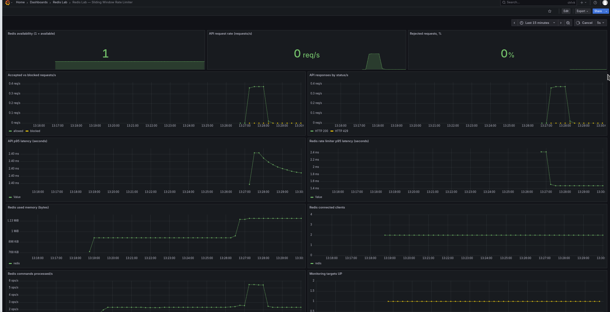

До начала основных тестов Redis доступен (`1`), интенсивность запросов в конце графика равна нулю. Небольшие всплески на графиках остались от ручных проверок API. Redis занимает около 1,1–1,2 МиБ памяти, к нему открыто примерно два соединения. Задержки приложения и обращения к Redis составляют всего несколько миллисекунд.

### Во время нагрузки

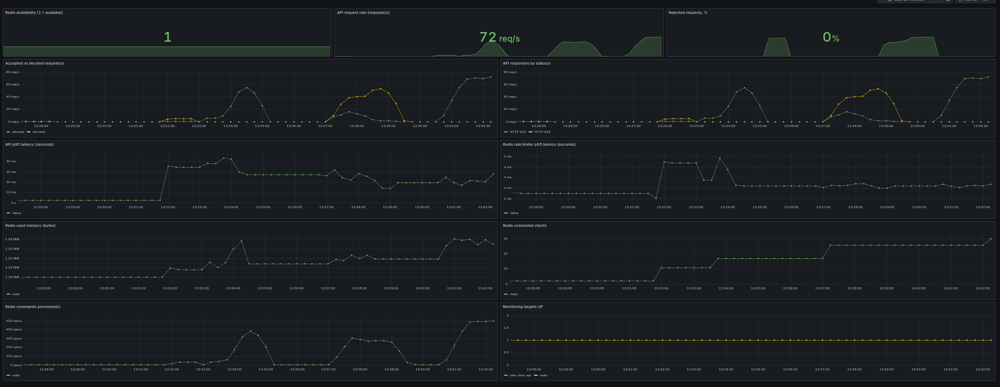

На дашборде хорошо видно влияние разных тестов на систему. Примерно в 13:32–13:35 появились первые всплески, в 13:37–13:39 заметно выросло число ответов 429, а с 13:41 началась следующая серия запросов от множества клиентов. В момент снимка интенсивность достигла примерно 72 запросов в секунду, при этом доля блокировок снова была 0%. Ранние всплески блокировок видны в истории графиков.

- **Redis availability и Monitoring targets UP** оставались равны 1 на показанном интервале. Система мониторинга продолжала получать данные.
- **Redis commands processed/s** выросло примерно до 500 операций в секунду. Это больше HTTP RPS, что ожидаемо: один вызов ограничителя выполняет внутри Redis несколько команд, а дополнительные команды выполняет мониторинг.
- **Redis connected clients** выросло примерно с 2 до 30 соединений. Это именно соединения приложения и других компонентов с Redis, а не количество логических клиентов API. Клиенты API не подключаются к Redis напрямую.
- **Redis used memory** выросла примерно с 1,2 до 1,3 МиБ. Рост небольшой. Старые ключи удаляются по TTL, но Redis не обязан немедленно возвращать всю занятую память к начальному значению.
- **API p95 latency** во время тестов поднималась примерно до 40–45 мс, а **Redis rate limiter p95 latency** — примерно до 5 мс. В дальнейшем задержка операции Redis находилась в районе 2–2,5 мс.


## Выводы

В итоге получилось развернуть сервис с Redis, проверить ограничение запросов и настроить мониторинг. По сравнению с предыдущей лабой по OpenSearch эта показалась мне намного проще именно в плане количества компонентов и их настройки. Хотя и тут пришлось какое-то время помучиться с Docker: сначала не скачивался GPG-ключ, потом уже установившийся Docker не мог скачать образы.
Самым интересным для меня было разобраться с тем, зачем вообще нужен Redis в таком приложении. Раньше я в основном воспринимал его как какой-то быстрый кеш, а тут оказалось, что на нем можно реализовать вполне самостоятельную логику. 
Еще было интересно посмотреть, как ведет себя один и тот же алгоритм при разном количестве клиентов. В третьем тесте вообще не было блокировок, хотя я их ожидал, и пришлось разбираться, почему так получилось.