# Лабораторная работа №4. Эксплуатация ClickHouse

## 1. Выбор уровня аналитики и описание задачи

Для этой лабораторной я выбрал сервисные метрики и логи. Решил сделать систему, которая собирает данные о работе микросервисов условного интернет-магазина, хранит их в ClickHouse и визуализирует в Grafana.

В качестве примера взял три сервиса:

- `auth` - авторизация пользователей
- `users` - работа с профилями пользователей
- `orders` - работа с заказами

Сами микросервисы я не разворачивал. Вместо этого написал генератор событий на Python, который имитирует уже обработанные HTTP-запросы. Для каждого события сохраняются время, название сервиса, HTTP-метод, маршрут, код ответа и время его обработки.

Основной задачей являлось по этим данным понять, насколько стабильно работает система, какой сервис получает больше всего запросов, где возникают ошибки и какие маршруты отвечают медленнее остальных. Также решил добавить возможность имитировать сбой одного из сервисов, чтобы проверить, насколько хорошо проблемы видны на графиках.

## 2. Выбор показателей

Для анализа работы сервисов выбрал следующие показатели:

| Показатель | Что показывает                                                                                                                                             |
| --- |------------------------------------------------------------------------------------------------------------------------------------------------------------|
| Количество запросов | Показывает общий объем событий за выбранный период                                                                                                         |
| RPS (Requests Per Second) | Позволяет оценить интенсивность запросов к каждому сервису                                                                                                 |
| Доля ошибок 5xx | Помогает заметить проблемы на стороне сервиса                                                                                                              |
| Среднее время ответа | Показывает, сколько в среднем занимает обработка запроса                                                                                                   |
| P95 времени ответа | Показывает границу, в которую укладывается примерно 95% запросов. Позволяет заметить медленные запросы, которые могут быть не так заметны по среднему значению |
| Распределение HTTP-кодов | Позволяет сравнить количество успешных запросов, клиентских и серверных ошибок                                                                             |
| Самые медленные маршруты | Помогает определить, какие HTTP-методы и endpoints работают медленнее остальных.                                                                           |
| Последние серверные ошибки | Позволяет посмотреть конкретные события с ошибками и понять, к какому сервису и маршруту они относятся.                                                    |

По сути, здесь использую подход RED (Rate, Errors, Duration): смотрю на интенсивность запросов, ошибки и время ответа. ClickHouse подходит для этой задачи, потому что нужно постоянно добавлять новые события, а затем выполнять аналитические запросы сразу по большому количеству записей.

## 3. Архитектура системы

Все компоненты разворачиваются на одной виртуальной машине с Ubuntu при помощи Ansible и Docker Compose. В качестве хранилища используется ClickHouse, в качестве источника событий - Python-генератор, а для визуализации - Grafana.

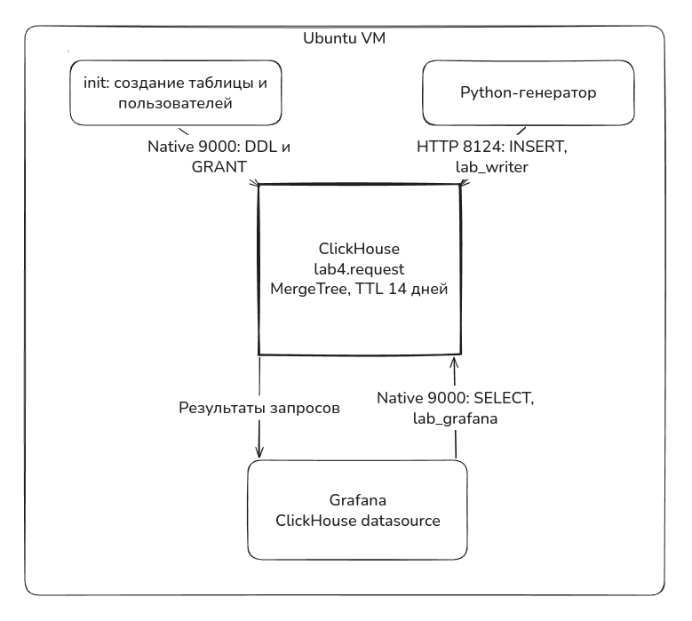


Контейнер `init` запускается после того, как ClickHouse проходит healthcheck, создает таблицу и пользователей, после чего завершается. Генератор и Grafana запускаются только после успешного завершения `init`.

Генератор отправляет данные напрямую в ClickHouse по HTTP на порт 8123. Grafana обращается к ClickHouse через официальный плагин grafana-clickhouse-datasource по Native Protocol на порту 9000. Порты самой базы наружу не пробрасываются, а Grafana доступна на 127.0.0.1:3000 виртуальной машины. Данные ClickHouse и Grafana сохраняются в Docker volumes.

## 4. Развертывание ClickHouse и остальных компонентов

Для автоматизации развертывания написал `ansible/playbook.yml`. Он устанавливает Docker и Docker Compose, настраивает зеркала Docker Hub, копирует файлы проекта в `/opt/lab4`, генерирует файл `.env`, запускает контейнеры и проверяет доступность HTTP API Grafana.

Для запуска использовал команду с локального компьютера:

```bash
ansible-playbook -i ansible/inventory.ini ansible/playbook.yml
```

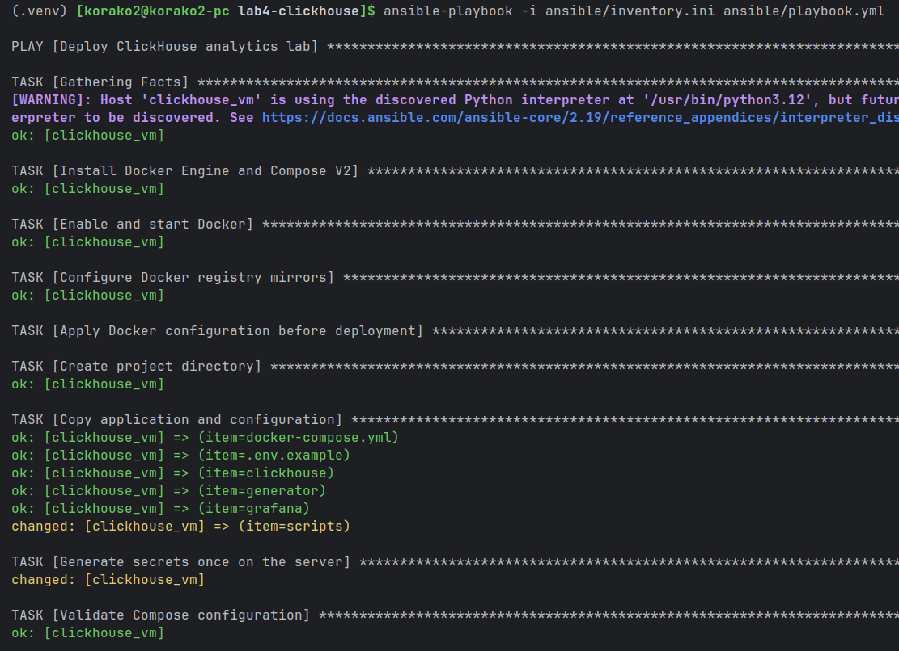


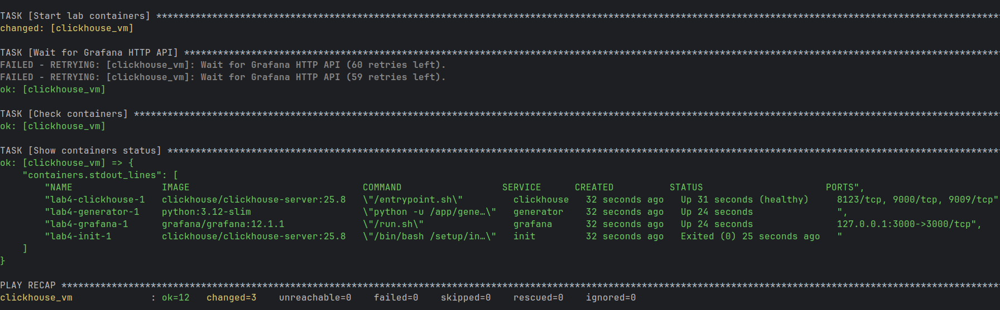

Grafana запустилась не сразу, поэтому Ansible несколько раз повторил проверку ее HTTP API. В итоге playbook отработал успешно: `ok=12`, `changed=3`, `unreachable=0`, `failed=0`.

После этого подключился к виртуальной машине, перешел в `/opt/lab4` и проверил состояние контейнеров:

```bash
cd /opt/lab4
sudo docker compose ps -a
```

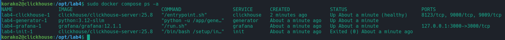

ClickHouse находится в состоянии `healthy`, генератор и Grafana работают. Контейнер `init` завершился с кодом `0`. Это ожидаемое поведение, так как он нужен только для инициализации базы.

### Проблемы при развертывании

С первого раза запустить все не получилось. Сначала возникли проблемы при скачивании Docker-образов. Для их решения, как и в предыдущих лабораторных, добавил в Ansible настройку зеркал Docker Hub (Timeweb, GitVerse и Yandex Cloud).


Разделил шаблон `.env.example` и итоговый `.env`. При исправлении путей еще возникла ошибка: проверка `creates` в Ansible и путь выходного файла в Python указывали на `.env.example`, из-за чего настоящий `.env` не создавался. После исправления этих путей система запустилась. В итоге шаблон копируется на сервер, а файл с паролями создается только при первом запуске.

## 5. Проектирование таблицы ClickHouse

Для хранения событий создал базу `lab4` и одну таблицу `requests`. Дополнительные агрегированные таблицы в рамках этой задачи не понадобились: все показатели рассчитываются SQL-запросами непосредственно по исходным событиям.

Содержимое `clickhouse/init.sql`:

```sql
CREATE DATABASE IF NOT EXISTS lab4;

CREATE TABLE IF NOT EXISTS lab4.requests
(
    timestamp DateTime('UTC'),
    service LowCardinality(String),
    endpoint LowCardinality(String),
    method LowCardinality(String),
    status_code UInt16,
    duration_ms UInt32
)
ENGINE = MergeTree()
PARTITION BY toDate(timestamp)
ORDER BY (timestamp, service)
TTL timestamp + INTERVAL 14 DAY DELETE;
```

Для проверки созданной таблицы подключился к ClickHouse:

```bash
sudo docker compose exec clickhouse bash -c \
  'clickhouse-client --user lab_admin --password "$CLICKHOUSE_PASSWORD"'
```

И выполнил запрос:

```sql
SHOW CREATE TABLE lab4.requests;
```

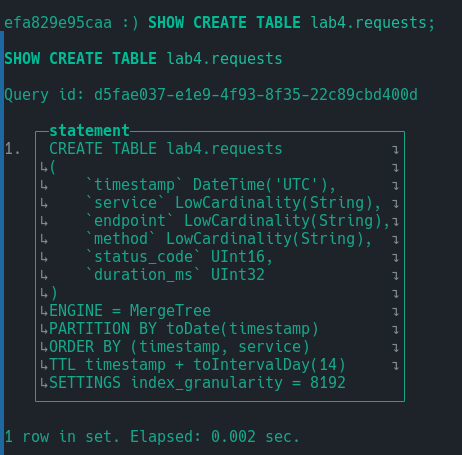

На скриншоте видно, что таблица действительно создана с нужными параметрами.

### Обоснование типов данных

| Поле | Тип данных | Почему выбрал |
| --- | --- | --- |
| timestamp | DateTime('UTC') | Для хранения времени события с точностью до секунды и единой временной зоной UTC. |
| service | LowCardinality(String) | Названия трех сервисов постоянно повторяются, поэтому удобно использовать словарное кодирование. |
| endpoint | LowCardinality(String) | Маршрутов немного, их значения тоже часто повторяются. |
| method | LowCardinality(String) | HTTP-методов в моем сценарии всего несколько. |
| status_code | UInt16 | Позволяет хранить HTTP-коды без использования строк. |
| duration_ms | UInt32 | Время обработки хранится целым неотрицательным числом в миллисекундах. |

В качестве движка выбрал `MergeTree`, так как он подходит для постоянной пакетной вставки событий и аналитических выборок.

Ключ сортировки - `(timestamp, service)`. Время поставил на первое место, потому что практически все запросы Grafana фильтруют данные по выбранному временному диапазону. Название сервиса используется вторым полем сортировки. Такой порядок удобен для анализа всех сервисов за определенный период, хотя для выборок только по одному сервису другой порядок ключа мог бы быть эффективнее.

Партиционирование настроил по дням. При хранении данных за 14 дней это дает небольшое количество партиций и позволяет не читать лишние дневные партиции при запросах за конкретный период. Через TTL настроил автоматическое удаление событий старше 14 дней в процессе фоновых слияний ClickHouse.

Также разделил доступ к базе между тремя пользователями: `lab_admin` используется для администрирования, `lab_writer` получает право `INSERT` на таблицу, а `lab_grafana` - право `SELECT`. Создание пользователей и выдача прав описаны в `clickhouse/init.sh`.

## 6. Генерация событий и загрузка данных

Для генерации данных написал `generator/generator.py`. Он работает в отдельном Docker-контейнере и использует стандартную библиотеку Python, поэтому дополнительные зависимости устанавливать не нужно.

Сервисы выбираются случайно с заданными вероятностями, а время ответа генерируется на основе логнормального распределения. Это позволяет получить не только обычные значения задержек, но и отдельные более медленные запросы.

| Сервис | Доля запросов | Медианное время ответа в норме | Вероятность 5xx в норме |
| --- | ---: | ---: | ---: |
| auth | 35% | 45 мс | 1% |
| users | 25% | 70 мс | 1% |
| orders | 40% | 120 мс | 1% |

Дополнительно вероятность клиентской ошибки (4xx) составляет 4%. Для каждого сервиса определен свой набор маршрутов и методов.

Каждые 5 секунд генератор создает пачку из 500 событий и отправляет их в ClickHouse одним HTTP-запросом с командой:

```sql
INSERT INTO lab4.requests FORMAT JSONEachRow
```

Таким образом, при нормальной работе получается около 100 событий в секунду. Использовал пакетную вставку, чтобы не выполнять отдельный `INSERT` для каждого события. Также в генераторе есть обработка ошибок отправки: если вставка не удалась, ошибка записывается в лог, пачка отбрасывается и генерация продолжается. Для учебного проекта этого достаточно, но в реальной системе стоило бы предусмотреть буферизацию и повторную доставку данных.

### Проверка поступления событий

Для начала выполнил запрос на количество записей в таблице два раза:

```sql
SELECT count()
FROM lab4.requests;
```

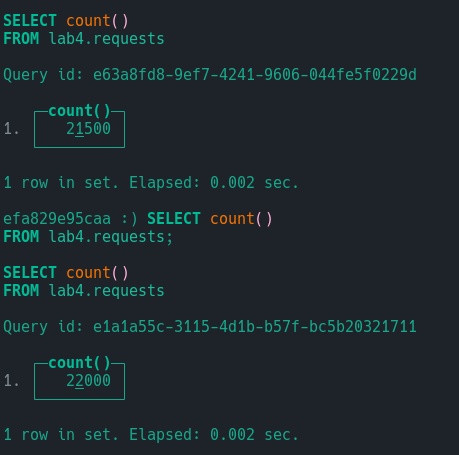

Количество событий увеличилось с 21 500 до 22 000. Разница составляет ровно 500 записей, то есть соответствует размеру одной пачки генератора.

Далее посмотрел содержимое последних записей:

```sql
SELECT *
FROM lab4.requests
ORDER BY timestamp DESC
LIMIT 15;
```

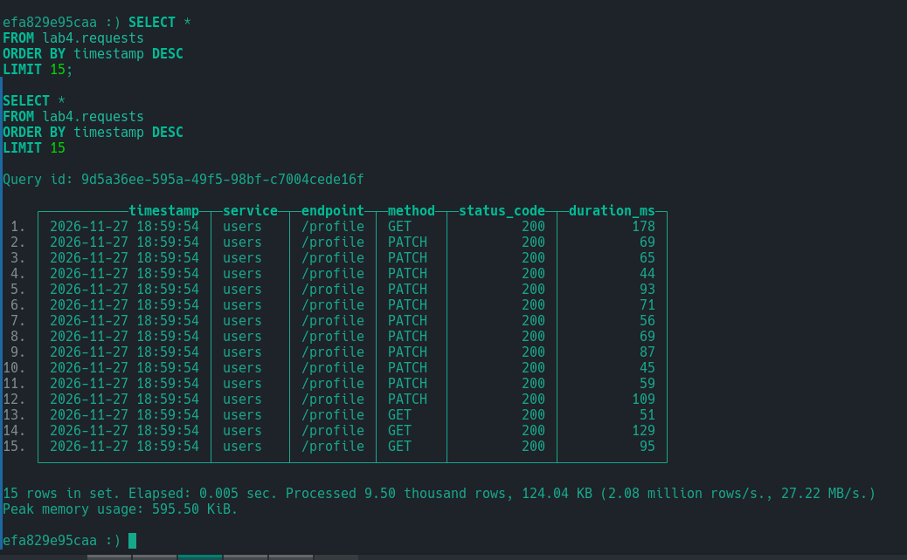

В таблице действительно присутствуют все нужные поля. На этом скриншоте в выборку попали события `users` с одинаковой секундой времени, поэтому здесь не видно всех трех сервисов. Их наличие проверил следующим аналитическим запросом.

### Аналитический SQL-запрос

```sql
SELECT
    service,
    count() AS requests,
    round(avg(duration_ms), 2) AS avg_ms,
    quantileExact(0.95)(duration_ms) AS p95_ms,
    round(100.0 * countIf(status_code >= 500) / count(), 2) AS error_pct
FROM lab4.requests
WHERE timestamp >= now() - INTERVAL 1 MINUTE
GROUP BY service
ORDER BY service;
```

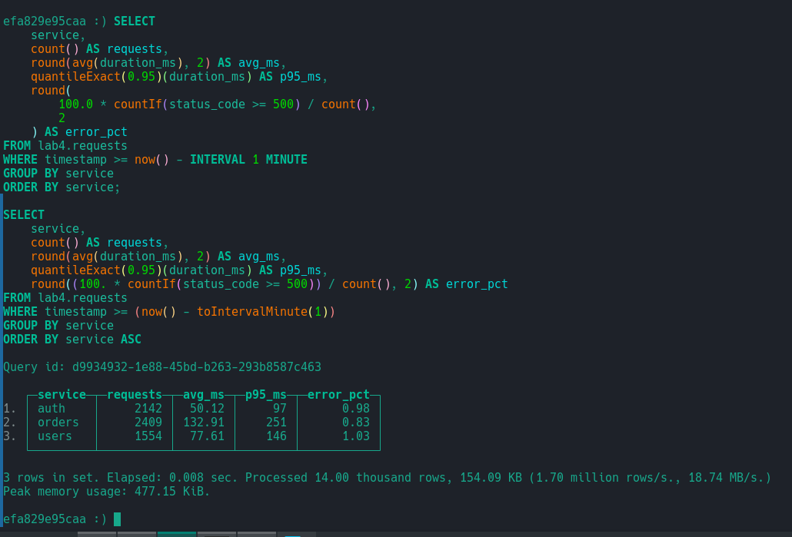


Запрос выполнился за 0.008 секунды. Общее количество событий за минуту составило 6105, что близко к заданной интенсивности генерации. Видно, что `orders` получает больше всего запросов и имеет самую высокую задержку, а доля ошибок у всех сервисов в нормальном режиме находится примерно на уровне 1%.

## 7. Настройка Grafana и создание дашборда

Grafana также разворачивается через Docker Compose. Для подключения ClickHouse использовал плагин grafana-clickhouse-datasource. Настройки источника данных описал в clickhouse.yml:

| Параметр | Значение |
| --- | --- |
| Источник данных | ClickHouse |
| Host | clickhouse |
| Port | 900 |
| Protocol | Native |
| Database | lab4 |
| Username | lab_grafana |

Пароль передается через переменную окружения. Сам дашборд хранится в services.json, а его автоматическое подключение описано в grafana/provisioning/dashboards/dashboards.yml. Благодаря этому после запуска не нужно вручную создавать источник данных и панели.


### Дашборд

Всего сделал 11 панелей:

| Панель | Что показывает |
| --- | --- |
| Total requests | Количество запросов за выбранный период. |
| 5xx error rate | Общую долю серверных ошибок. |
| Average latency | Среднюю задержку по всем сервисам. |
| P95 latency | Общий 95-й перцентиль задержки. |
| Requests per second by service | Интенсивность запросов отдельно по сервисам. |
| 5xx error rate by service | Изменение доли ошибок отдельно по сервисам. |
| P95 latency by service | Изменение P95 отдельно по сервисам. |
| Average latency by service | Изменение средней задержки отдельно по сервисам. |
| HTTP status classes | Распределение кодов 2xx, 4xx и 5xx. |
| Slowest endpoints (by P95) | Маршруты с наибольшим P95, включая число запросов, среднее время и долю ошибок. |
| Recent server errors | Последние события с серверными ошибками. |


## 8. Проверка работы системы на примере инцидента

### 8.1. Нормальная работа

Сначала оставил генератор работать в обычном режиме и посмотрел на дашборд.

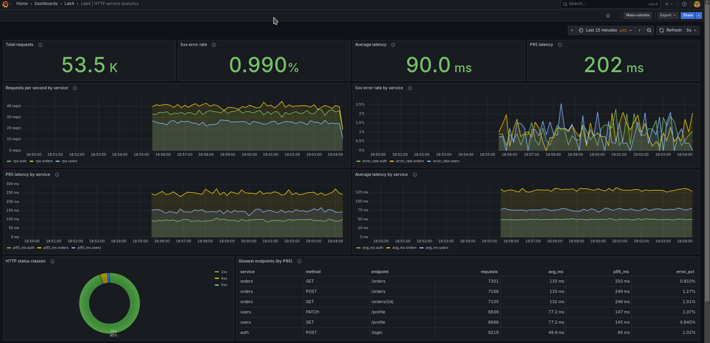

На момент скриншота в выбранном диапазоне было около 53.5 тыс. запросов, общая доля ошибок составляла 0.990%, среднее время ответа - 90 мс, а P95 - 202 мс.

По графикам видно, что интенсивность запросов соответствует настройкам генератора: около 35 RPS для `auth`, 25 RPS для `users` и 40 RPS для `orders`. Доля ошибок колеблется около 1%, а задержки каждого сервиса остаются примерно на одном уровне. Небольшие колебания возникают из-за случайной генерации событий.

Дополнительно посмотрел нижнюю панель с последними ошибками:

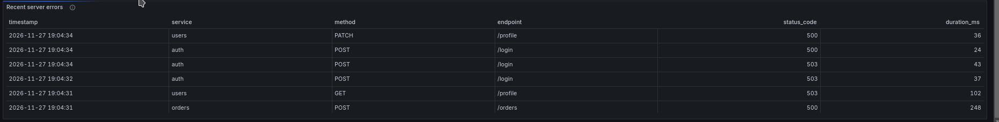

Здесь можно увидеть время события, сервис, маршрут, метод, код ошибки (500 или 503) и время ответа. То есть при необходимости можно посмотреть не только общий процент ошибок, но и конкретные записи.

### 8.2. Имитация инцидента

В генератор добавил возможность имитировать проблемы сервиса `orders`. Для включения этого режима достаточно создать файл `/tmp/incident` внутри контейнера:

```bash
sudo docker compose exec generator touch /tmp/incident
sudo docker compose logs --tail=5 generator
```

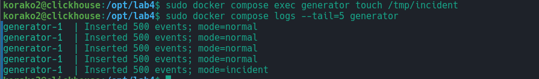

В логах видно, что генератор переключился с `mode=normal` на `mode=incident` и продолжил отправлять по 500 событий.

В этом режиме вероятность серверной ошибки у `orders` увеличивается с 1% до 35%, а медианная задержка - в 7 раз, со 120 до 840 мс. Параметры `auth` и `users` остаются прежними. Интенсивность генерации тоже не меняется.

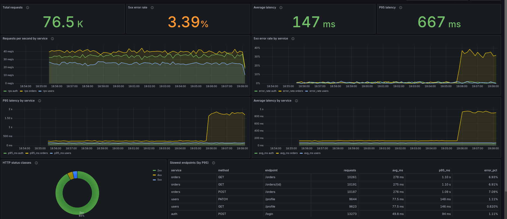

Примерно в 19:06 UTC на графиках стал заметен резкий рост ошибок и задержек `orders` (желтая линия). Доля ошибок этого сервиса поднялась примерно до 30-40%, средняя задержка - до 900-950 мс, а P95 - примерно до 1.7 секунды. При этом графики `auth` и `users` практически не изменились, как и количество запросов в секунду.

Общие показатели за выбранный на дашборде диапазон также выросли: доля ошибок до 3.39%, средняя задержка до 147 мс, P95 до 667 мс. Эти значения ниже мгновенных показателей `orders`, потому что учитывают также остальные сервисы и события, полученные до инцидента.

### 8.3. Восстановление работы

Для отключения режима инцидента удалил файл:

```bash
sudo docker compose exec generator rm -f /tmp/incident
sudo docker compose logs --tail=5 generator
```

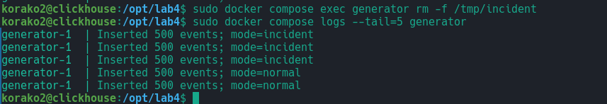

В логах видно, что генератор снова перешел в режим `normal`.

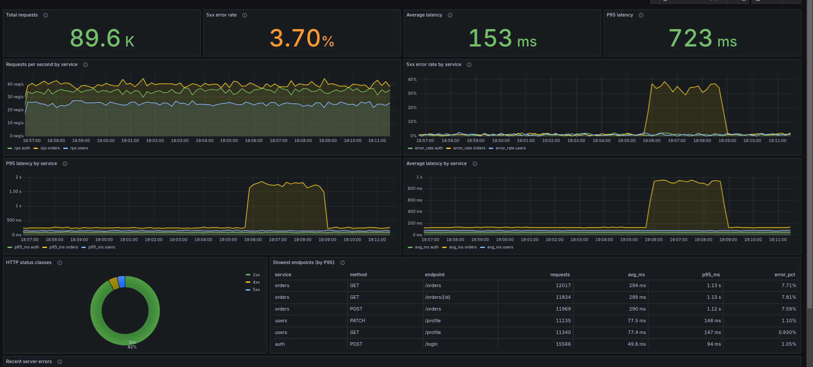

На итоговом дашборде хорошо видны все три этапа: нормальная работа, инцидент примерно с 19:06 до 19:09 UTC и возвращение к нормальным значениям. После отключения инцидента доля ошибок `orders` снова находится примерно на уровне 1%, средняя задержка - около 130 мс, P95 - около 250 мс.

### Сравнение результатов

Значения верхних панелей Grafana на трех скриншотах:

| Показатель | До инцидента | Во время инцидента | После восстановления |
| --- | ---: | ---: | ---: |
| Количество запросов в выбранном диапазоне | 53.5 тыс. | 76.5 тыс. | 89.6 тыс. |
| Общая доля ошибок 5xx | 0.990% | 3.39% | 3.70% |
| Среднее время ответа | 90 мс | 147 мс | 153 мс |
| Общий P95 | 202 мс | 667 мс | 723 мс |

На последнем скриншоте общие показатели еще не вернулись к норме и даже немного выросли по сравнению со скриншотом во время инцидента. Это не означает, что сервис продолжает работать с ошибками. Верхние панели рассчитываются за весь выбранный диапазон времени, в который все еще входят события инцидента. Для проверки восстановления нужно смотреть последние точки графиков по сервисам.

Если сравнивать именно участки графиков `orders`, получается следующая картина (значения приблизительные):

| Показатель `orders` | До инцидента | Во время инцидента | После восстановления |
| --- | ---: | ---: | ---: |
| RPS | ~40 | ~40 | ~40 |
| Доля 5xx | ~1% | ~30-40% | ~1% |
| Среднее время ответа | ~130 мс | ~900-950 мс | ~130 мс |
| P95 | ~250 мс | ~1.7-1.8 с | ~250 мс |

В результате получилось показать, что рост задержек и ошибок можно обнаружить даже при неизменной интенсивности запросов. Причем по графикам сразу понятно, какой конкретно сервис работает хуже остальных.


## 9. Вывод

В этой лабораторной было интересно поработать с ClickHouse, особенно после MongoDB, OpenSearch и Redis. Здесь уже совсем другой подход: не просто записать данные, а потом быстро посчитать по ним нужные показатели. Для себя разобрался с MergeTree, ключами сортировки и партиционированием, а также с тем, как рассчитывается P95 и чем он полезнее одного только среднего времени ответа.


Самым интересным было включить имитацию инцидента и увидеть, как именно у одного сервиса на графиках резко растут задержки и ошибки, а после отключения все возвращается к норме. В целом теперь гораздо лучше понимаю, зачем ClickHouse используют для аналитики сервисных событий и как связать его с Grafana без дополнительных компонентов.
